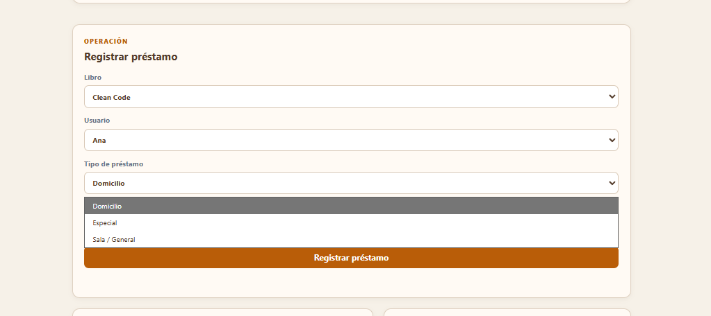
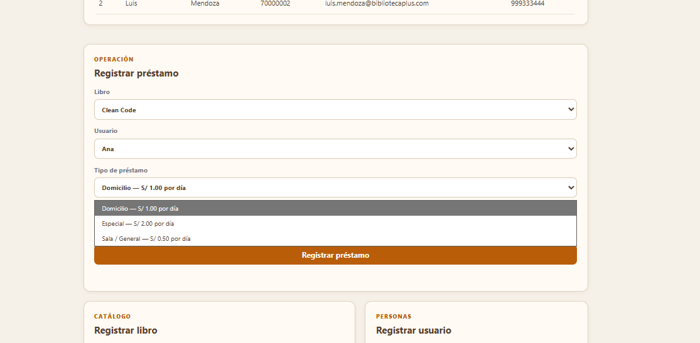

# RFC-001 · OCP: Estrategias para tarifas de multa

## Relación con RFC-001

Este documento registra la corrección de OCP-01 y OCP-02 dentro de la refactorización exhaustiva RFC-001.

## Hallazgo

El cálculo de multas dependía de condicionales por tipo de préstamo dentro de `CalculadorMulta`. Para agregar una nueva tarifa era necesario modificar la clase principal.

## Código anterior

```java
if ("ESPECIAL".equalsIgnoreCase(tipoPrestamo)) {
    return 2.0;
}
if ("DOMICILIO".equalsIgnoreCase(tipoPrestamo)) {
    return 1.0;
}
return 0.5;
```

## Solución aplicada

Se creó la interfaz `TarifaMulta` y estrategias independientes:

```java
public interface TarifaMulta {
    boolean aplicaA(String tipoPrestamo);
    double valorDiario();
}
```

Las implementaciones actuales son `TarifaDomicilio`, `TarifaEspecial` y `TarifaGeneral`. `CalculadorMulta` recibe la lista de estrategias mediante inyección y selecciona la que corresponde:

```java
return tarifas.stream()
        .filter(tarifa -> tarifa.aplicaA(tipoPrestamo))
        .findFirst()
        .orElseThrow(() -> new IllegalArgumentException("No existe una tarifa configurada"))
        .valorDiario() * diasRetraso;
```

La interfaz también expone las tres alternativas con su tarifa diaria: `Domicilio — S/ 1.00 por día`, `Especial — S/ 2.00 por día` y `Sala / General — S/ 0.50 por día`. De esta manera, cada estrategia implementada puede seleccionarse, comprenderse y probarse desde el sistema.





## Resultado

- Las estrategias existentes no necesitan modificarse para agregar otra tarifa.
- El cálculo está abierto a extensiones y cerrado a modificaciones internas.
- Cada tarifa puede probarse de manera independiente.

## Validación automatizada

`CalculadorMultaTest` verifica las tarifas de domicilio, especial y general. Las pruebas Maven finalizaron con `BUILD SUCCESS`.
