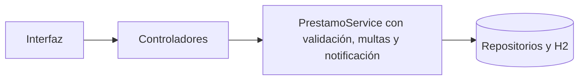
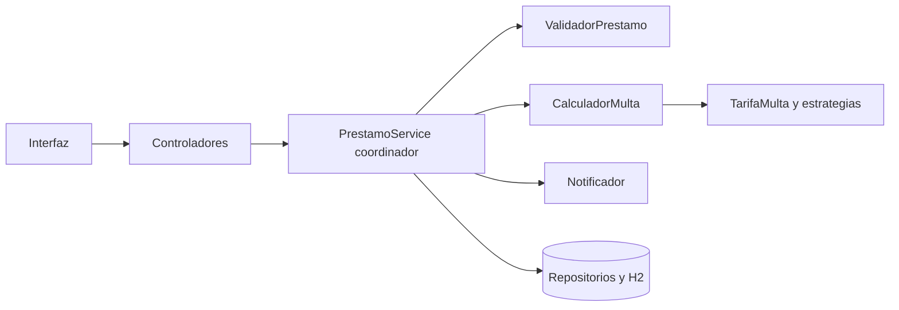

# RFC-001: Refactorización exhaustiva del sistema BibliotecaPlus

## Justificación del número RFC-001

Este RFC se identifica como RFC-001 porque representa la refactorización exhaustiva de la solución completa. No corresponde necesariamente al primer cambio implementado en el proyecto: se planteó después de completar una versión funcional y de atender los RFC-002 al RFC-006.

Los RFC-002 al RFC-006 se desarrollaron según la importancia y las necesidades detectadas durante la evolución del sistema, no siguiendo un orden estrictamente numérico. Una vez estabilizada la funcionalidad, se realiza este análisis transversal para mejorar la estructura interna sin cambiar el comportamiento esperado.

## Objetivo

Después del diagnóstico del software inicial, se solicita refactorizar la arquitectura interna aplicando DRY, Responsabilidad Única, Abierto/Cerrado e Inversión de Control, conservando el comportamiento funcional del sistema.

## Análisis profundo del sistema

La revisión del código, los servicios, los controladores y el flujo de préstamos permitió identificar ocho hallazgos estructurales:

| Código | Principio | Hallazgo del análisis | Corrección prevista |
|---|---|---|---|
| DRY-01 | DRY | Validaciones repetidas en servicios | Centralizar validaciones reutilizables |
| DRY-02 | DRY | Cálculo de multas mediante reglas repetidas | Extraer el cálculo a un componente |
| SRP-01 | Responsabilidad Única | `PrestamoService` concentra préstamo, devolución y multa | Separar las responsabilidades |
| SRP-02 | Responsabilidad Única | `PrestamoService` realiza notificaciones | Extraer la notificación |
| OCP-01 | Abierto/Cerrado | Condicionales por tipo de préstamo | Usar estrategias de tarifa |
| OCP-02 | Abierto/Cerrado | Agregar una regla exige modificar la clase principal | Permitir extensiones mediante interfaces |
| IOC-01 | Inversión de Control | Dependencias creadas directamente en el diseño inicial | Recibir dependencias por constructor |
| IOC-02 | Inversión de Control | Notificador acoplado al servicio | Inyectar un componente de notificación |

## Avance de correcciones

- DRY-01: corregido mediante `ValidadorDatos`, reutilizado por los servicios de usuarios, libros y préstamos.
- DRY-02: corregido mediante `CalculadorMulta`, separado de `PrestamoService` y validado con pruebas unitarias.
- SRP-01/SRP-02: corregidos mediante `ValidadorPrestamo` y `NotificadorPrestamo`.
- OCP-01/OCP-02: corregidos mediante la interfaz `TarifaMulta` y estrategias de tarifa independientes.
- IoC-01/IoC-02: corregidos mediante la interfaz `Notificador` y la inyección de dependencias por constructor.

## Alcance de la refactorización

El análisis considera duplicación de reglas, concentración de responsabilidades, dependencia de condicionales para extender comportamientos y acoplamiento entre componentes. Estos hallazgos afectan principalmente el mantenimiento, la posibilidad de agregar nuevas reglas y la facilidad para probar cada parte del sistema.

## Plan de corrección

1. Registrar el diagnóstico y los hallazgos.
2. Extraer la validación y las reglas reutilizables.
3. Separar notificaciones y responsabilidades del préstamo.
4. Aplicar estrategias para las tarifas.
5. Revisar y demostrar la inyección de dependencias.
6. Ejecutar pruebas y documentar el comportamiento antes/después.

## Validación automatizada

El proyecto utiliza JUnit 5 y Mockito mediante la dependencia `spring-boot-starter-test`. Las pruebas de caja cerrada verifican el comportamiento observable de los servicios sin depender de la implementación interna.

Se ejecutan automáticamente con:

```powershell
mvn test
```

El resultado de cada ejecución queda registrado por Maven en `target/surefire-reports/`, sin necesidad de capturas de pantalla.

## Verificación previa a la refactorización

Antes de aplicar las correcciones del RFC-001 se realizó una revisión de compilación, pruebas automatizadas, servicios, repositorios, controladores y flujo de préstamos. La revisión confirmó que los hallazgos estructurales se agrupan en los ocho puntos de la tabla anterior y que no se identificó un noveno defecto funcional independiente.

Las observaciones de notificación, reglas condicionales, validaciones agrupadas y dependencias forman parte de los hallazgos SRP, OCP, DRY e IoC ya definidos. El resto de la solución conserva separación por capas, inyección por constructor, repositorios Spring Data, respuestas HTTP controladas y pruebas automatizadas.

Resultado de la verificación automática: `BUILD SUCCESS`.

## Evidencia de Git

Cada corrección se registrará en un commit independiente, con una descripción de qué archivo se modificó, qué problema se corrigió y qué principio se aplicó.

## Gestión en GitHub

La solicitud y aprobación de este cambio se administra mediante la plantilla obligatoria de RFC ubicada en `.github/ISSUE_TEMPLATE/rfc.md`. El flujo de etiquetas y aprobación está documentado en `docs/gestion-rfc-github.md`.

## Diagrama de arquitectura antes y después

### Antes del análisis



### Después de la refactorización



La segunda estructura distribuye responsabilidades, permite extender tarifas y mantiene las dependencias bajo control de Spring.
