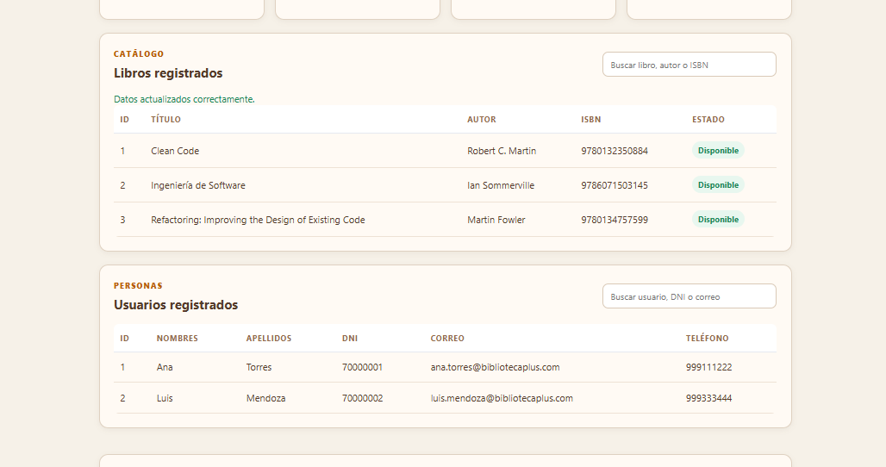
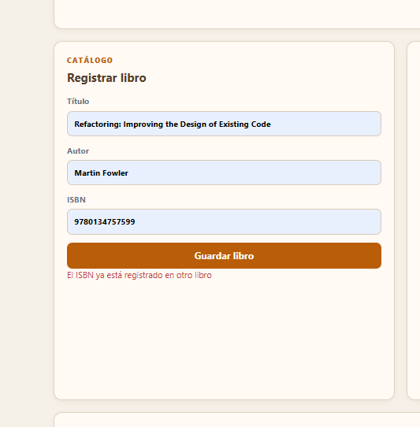

# RFC-002: Validación de ISBN duplicado

## Solicitud

Impedir que se registren dos libros con el mismo ISBN.

## Motivo

El ISBN identifica de forma única una edición de un libro. Permitir duplicados genera ambigüedad en el catálogo y puede afectar la disponibilidad y los préstamos.

## Implementación

- `LibroRepository.java`: agregó consultas para detectar ISBN existentes.
- `LibroService.java`: valida el ISBN antes de guardar o actualizar.
- `Libro.java`: agregó una restricción única y no nula en la base de datos.
- `LibroController.java`: convierte los errores de validación en respuestas HTTP 400.
- `app.js`: muestra el mensaje enviado por la API en el formulario.

## Evidencias del proceso

### Catálogo con el tercer libro registrado



La tabla muestra el tercer libro registrado correctamente con el ISBN `9780134757599`.

### Rechazo del ISBN repetido



Después se intentó registrar nuevamente el mismo libro y el sistema rechazó la operación con el mensaje `El ISBN ya está registrado en otro libro`. El catálogo conservó un solo registro para ese ISBN.

## Regla de negocio

```text
Si el ISBN ya existe, no se guarda el libro.
```

## Prueba funcional

1. Abrir la sección `Registrar libro`.
2. Completar un libro nuevo usando el ISBN de un libro existente.
3. Presionar `Guardar libro`.
4. Verificar el mensaje `El ISBN ya está registrado en otro libro`.
5. Confirmar que el catálogo no agrega un segundo registro.

## Buenas prácticas aplicadas

- La regla de negocio permanece en `LibroService`.
- La persistencia y la restricción de unicidad permanecen en la entidad y el repositorio.
- El controlador solo traduce excepciones a respuestas HTTP.
- La interfaz solo presenta el resultado y no contiene lógica de base de datos.
