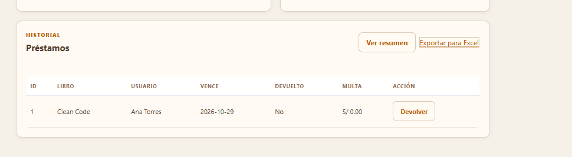
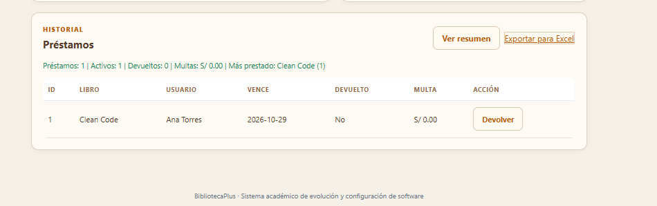
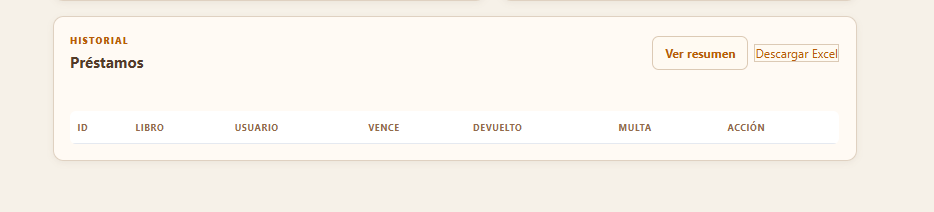
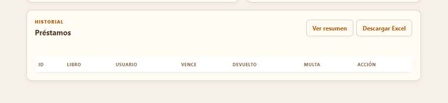

# RFC-003: Reportes y exportación de préstamos

## Solicitud

Consultar los préstamos registrados, conocer los libros más prestados y exportar la información para abrirla en Excel.

## Implementación

- `ReporteService.java`: concentra la generación del resumen y la conversión de préstamos a filas de reporte.
- `ReporteController.java`: expone el resumen JSON y la descarga CSV.
- `index.html`: agrega las acciones `Ver resumen` y `Exportar para Excel`.
- `app.js`: muestra los indicadores principales en la interfaz.

## Mejora visual posterior

Inicialmente la acción de exportación se mostraba como un enlace de texto. Durante la verificación se comprobó que el resumen funcionaba correctamente, pero el enlace de descarga no respetaba el diseño visual del sistema. El motivo fue que los estilos generales de los enlaces sobrescribían el estilo de botón.

El cambio se desarrolló en cuatro pasos:

1. Se implementó el resumen con indicadores de préstamos, devoluciones, multas y libro más prestado.
2. Se agregó la descarga del archivo `reporte-prestamos.csv`, compatible con Excel.
3. Se detectó visualmente que `Exportar para Excel` todavía aparecía como enlace de texto.
4. Se reforzó el estilo del enlace con la clase `report-download`, se cambió el texto a `Descargar Excel` y se agregó descarga directa.

El resultado final es un botón consistente con `Ver resumen`, sin modificar la lógica del reporte ni mezclar responsabilidades.

La prueba del resumen confirmó que los indicadores se muestran correctamente. También se identificó que el enlace de descarga aún conservaba apariencia de texto; por ello se reforzó su estilo con un botón visual uniforme.

## Reportes disponibles

- Total de préstamos.
- Préstamos activos.
- Préstamos devueltos.
- Total acumulado de multas.
- Libros más prestados.
- Detalle de préstamos con libro, usuario, fechas, estado y multa.

## Exportación

El archivo se descarga como `reporte-prestamos.csv`. Está codificado en UTF-8 y utiliza punto y coma como separador, por lo que puede abrirse directamente con Excel.

## Buenas prácticas

La lógica de cálculo está separada en `ReporteService`; el controlador solo expone los endpoints y la vista únicamente inicia la consulta o descarga.

## Prueba funcional

1. Registrar o consultar préstamos existentes.
2. Presionar `Ver resumen`.
3. Verificar los totales y el libro más prestado.
4. Presionar `Exportar para Excel`.
5. Abrir el archivo descargado y verificar sus columnas.
