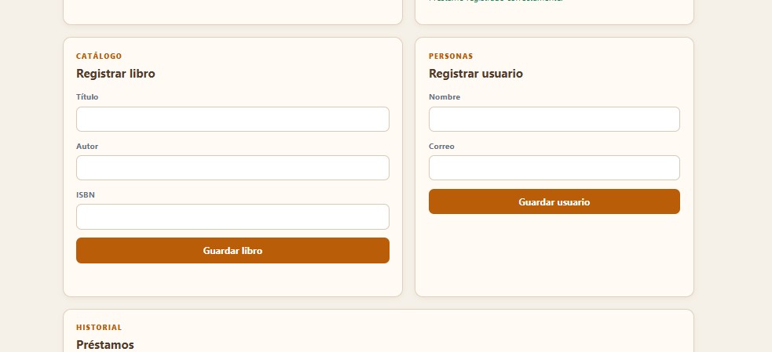
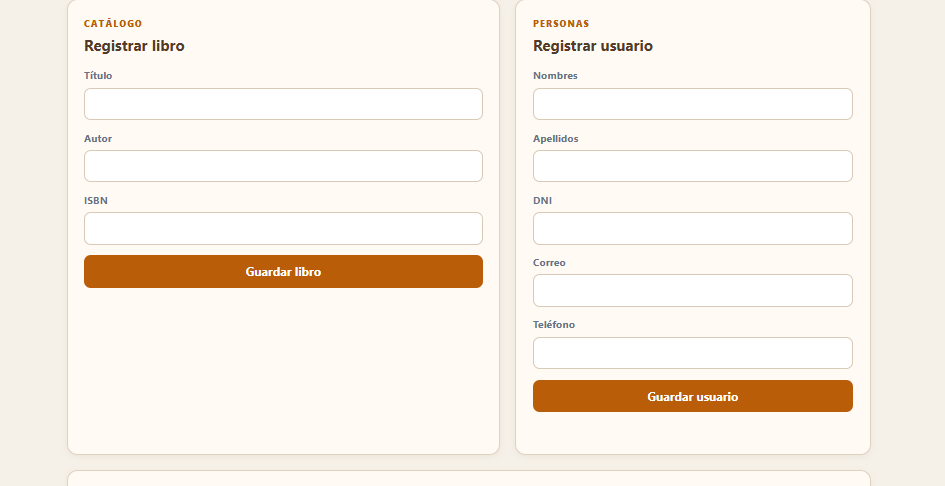

# RFC 005 Mejora de información del usuario

## Solicitud

Ampliar los datos de los usuarios de BibliotecaPlus para mejorar su identificación y comunicación.

## Alcance

Cada usuario tendrá:

- Nombres.
- Apellidos.
- DNI.
- Correo electrónico.
- Número telefónico.

La validación de DNI duplicado queda fuera de este RFC y será implementada en el RFC-006.

## Archivos involucrados

- `Usuario.java`: agregó apellidos, DNI y teléfono.
- `UsuarioService.java`: validó que los nuevos datos sean obligatorios.
- `DataInitializer.java`: actualizó los usuarios iniciales.
- `index.html`: agregó campos y columnas de usuario.
- `app.js`: envió, filtró y mostró los nuevos datos.

## Buenas prácticas aplicadas

- El modelo concentra los datos del usuario.
- El servicio concentra las validaciones.
- La vista solo captura y muestra información.
- La validación de duplicados se mantiene como una responsabilidad separada para RFC-006.
- El DNI y el teléfono se manejan como texto para conservar ceros iniciales.

## Pruebas previstas

1. Registrar un usuario con todos los campos completos.
2. Verificar que los nuevos datos aparezcan en la tabla.
3. Buscar por nombre, apellido, DNI o correo.
4. Intentar registrar un usuario incompleto y verificar el mensaje de validación.
5. Confirmar que el préstamo muestre nombres y apellidos del usuario.

## Evidencia visual

La captura anterior muestra que el formulario solo solicitaba nombre y correo.

La captura posterior muestra los nuevos campos de nombres, apellidos, DNI, correo y teléfono.
