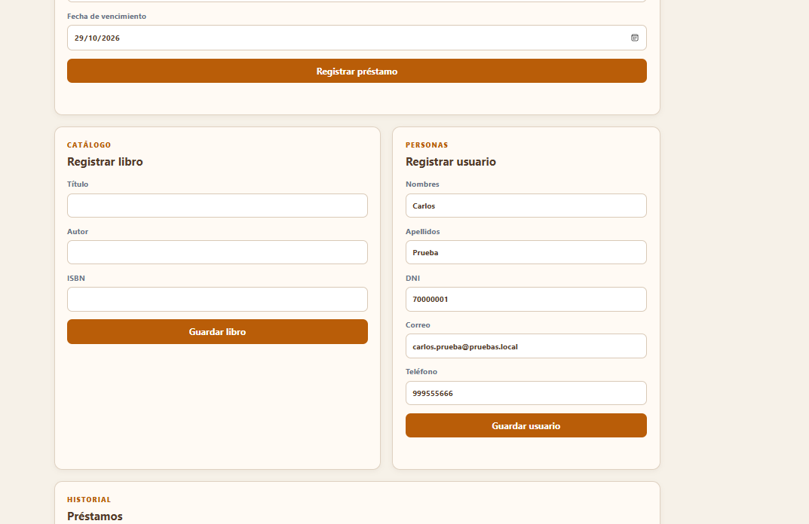
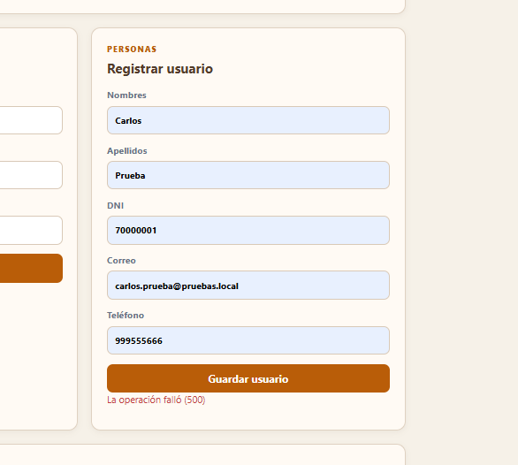
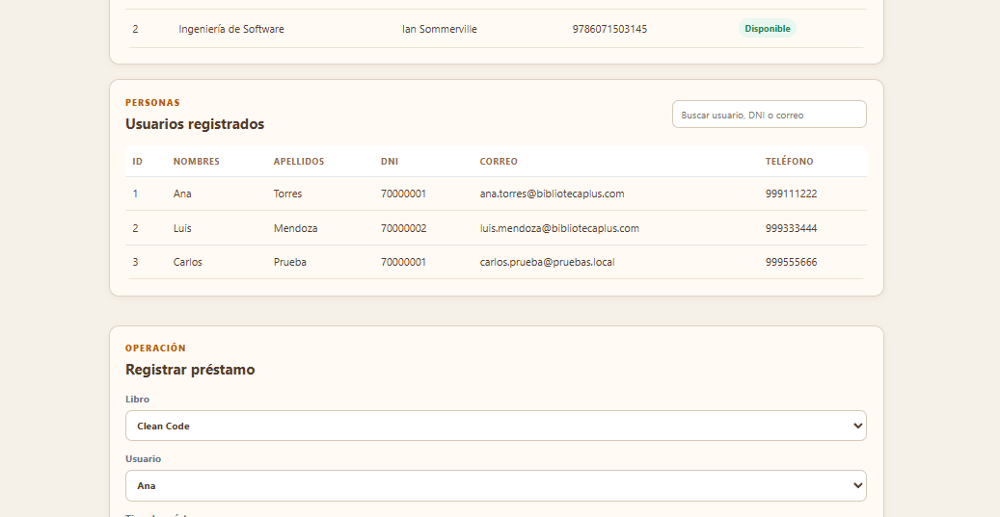
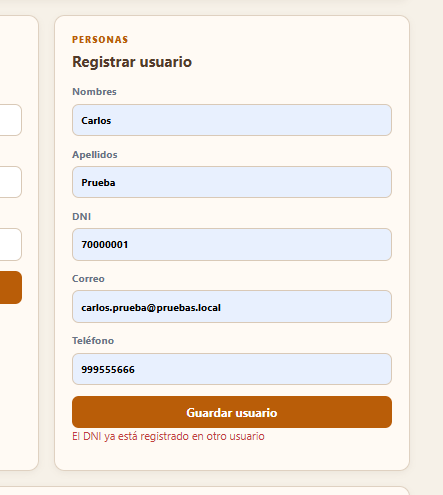

# RFC 006 Validación de DNI duplicado

## Solicitud

Evitar que dos usuarios sean registrados con el mismo DNI.

## Motivo

El DNI identifica de manera única a una persona. Permitir duplicados ocasionaría registros ambiguos y dificultaría el control de préstamos.

## Implementación

- `UsuarioRepository.java`: agregó consultas `existsByDni` y `existsByDniAndIdNot`.
- `UsuarioService.java`: valida el DNI antes de guardar o actualizar.
- `Usuario.java`: agregó una restricción única y no nula sobre el campo `dni`.
- `UsuarioController.java`: convierte los errores de validación y de restricción de base de datos en respuestas HTTP 400 controladas.
- `app.js`: muestra el mensaje enviado por la API cuando el registro es rechazado.

## Corrección detectada durante la prueba

En la primera ejecución, el DNI repetido llegó a generar el mensaje genérico `La operación falló (500)`. Esto evidenció que la excepción del servidor no estaba siendo traducida a un mensaje funcional para la persona usuaria.

Se corrigió separando responsabilidades:

1. La entidad `Usuario` mantiene la regla de unicidad en la base de datos.
2. `UsuarioService` aplica la validación de negocio antes de guardar.
3. `UsuarioController` transforma las excepciones en una respuesta `400` con un mensaje comprensible.
4. `app.js` presenta ese mensaje en el formulario sin mezclar lógica de persistencia con lógica visual.

## Regla

```text
Si el DNI ya existe, no se guarda el usuario.
```

## Prueba funcional

1. Registrar un usuario con un DNI nuevo.
2. Intentar registrar otro usuario usando el mismo DNI.
3. Verificar el mensaje `El DNI ya está registrado en otro usuario`.
4. Confirmar que la tabla conserva un solo registro con ese DNI.

## Evidencias del proceso

- `rfc-006-formulario-dni-repetido.png`: formulario usado para reproducir la situación.
- `rfc-006-error-500-antes-de-correccion.png`: evidencia del error inicial detectado.
- `rfc-006-tabla-con-duplicado-antes.png`: evidencia del comportamiento incorrecto inicial.
- `rfc-006-rechazo-dni-repetido.png`: resultado final después de aplicar la corrección.

## Evidencias recibidas

### Formulario con DNI repetido



### Resultado inicial observado



### Registro duplicado observado antes de reforzar la validación



### Mensaje final después de la corrección



La prueba se repitió después de reiniciar la aplicación usando el DNI `70000001`, que ya pertenece a Ana Torres. El sistema rechazó el nuevo registro, mostró el mensaje correcto y no agregó al usuario Carlos a la tabla.
