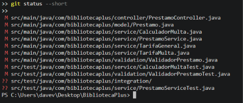
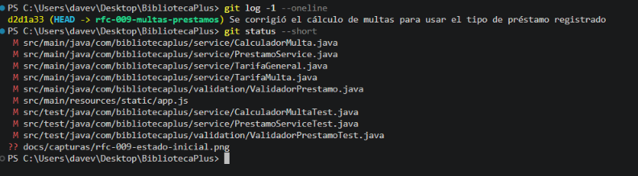
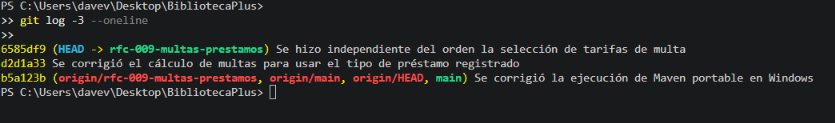
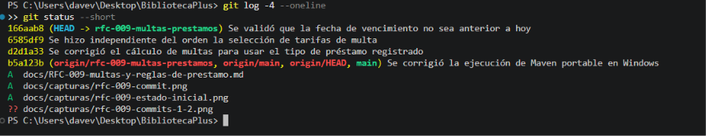

# RFC-009 · Corrección de multas y reglas de préstamo

| Campo | Valor |
|---|---|
| Issue | [#9](https://github.com/nn-nnhub/BibliotecaPlus/issues/9) |
| Tipo de mantenimiento | Correctivo |
| Riesgo | Medio |
| Prioridad | Alta |
| Costo estimado | Medio |
| Responsable | Dave Villacorta |
| Fecha propuesta | 17/10/2026 |
| Etiquetas | RFC · Alta · Refactor |

## Relación con el RFC

Este RFC corrige el cálculo de multas según el tipo real de préstamo, valida las fechas de vencimiento y hace que la selección de tarifas no dependa del orden de los componentes. Aborda tres hallazgos verificados con pruebas en una base H2 aislada (sin tocar `./data`):

| Hallazgo | Defecto |
|---|---|
| H1 | La multa dependía del tipo que enviaba el cliente al devolver, no del tipo del préstamo. |
| H5 | Se aceptaban fechas de vencimiento anteriores a hoy. |
| H6 | La tarifa elegida dependía del orden de la lista inyectada. |

También se retiró una variable sin uso (`diasPrestamo`) de `PrestamoService.devolver`.

## Hallazgo

**H1 — multa según el cliente.** El préstamo no guardaba su tipo y `devolver` recibía el tipo como parámetro. La interfaz enviaba siempre `DOMICILIO`, de modo que un préstamo ESPECIAL con 10 días de retraso generaba S/ 10.00 en lugar de S/ 20.00.

**H5 — vencimientos pasados.** `registrar` solo comprobaba que la fecha no fuera nula. Un vencimiento 10 días en el pasado se aceptaba (la API respondía 201).

**H6 — dependencia del orden.** `CalculadorMulta` tomaba la primera tarifa que aplicara. `TarifaGeneral.aplicaA` devuelve `true` para cualquier tipo; con la lista `[General, Domicilio, Especial]`, `calcular("ESPECIAL")` devolvía 0.5 en lugar de 2.0. En ejecución normal funcionaba solo por el orden alfabético de los beans.

## Código anterior

`PrestamoService.devolver` (el tipo llega del cliente):

```java
public Prestamo devolver(Long prestamoId, String tipoPrestamo) {
    ...
    long diasPrestamo = ChronoUnit.DAYS.between(prestamo.getFechaPrestamo(), fechaDevolucion);
    ...
    prestamo.setMulta(calculadorMulta.calcular(tipoPrestamo, diasRetraso));
```

`PrestamoService.registrar` (solo se valida que no sea nula):

```java
throw new IllegalArgumentException("La fecha de vencimiento es obligatoria");
```

`CalculadorMulta.calcular` (primera tarifa que aplique):

```java
return tarifas.stream()
        .filter(tarifa -> tarifa.aplicaA(tipoPrestamo))
        .findFirst()
        .orElseThrow(() -> new IllegalArgumentException("No existe una tarifa configurada"))
        .valorDiario() * diasRetraso;
```

`app.js` (tipo fijo al devolver):

```js
await consultar(`/api/prestamos/${id}/devolver?tipoPrestamo=DOMICILIO`, { method: 'PUT' });
```

## Solución aplicada

- **`Prestamo.java`**: nuevo campo `tipoPrestamo`. `getTipoPrestamo()` devuelve `DOMICILIO` si el valor es nulo (`TIPO_POR_DEFECTO`).
- **`PrestamoService.java`**: `registrar` guarda el tipo normalizado (`trim` y mayúsculas; vacío equivale a `DOMICILIO`) y `devolver(Long id)` calcula la multa con el tipo guardado.
- **`PrestamoController.java`**: `PUT /api/prestamos/{id}/devolver` ya no recibe `tipoPrestamo`.
- **`TarifaMulta.java` y `TarifaGeneral.java`**: método `esPorDefecto()`; solo la tarifa general devuelve `true`.
- **`CalculadorMulta.java`**: elige primero una tarifa específica y recurre a la general si ninguna aplica.
- **`ValidadorPrestamo.java`**: `validarVencimiento` rechaza fechas nulas o anteriores a hoy (hoy es válido).
- **`app.js`**: la devolución no envía el tipo y `#fechaVencimiento` usa `min` con la fecha local (no UTC, que en Perú adelantaría el día después de las 19:00).

```java
private TarifaMulta seleccionarTarifa(String tipoPrestamo) {
    return tarifas.stream()
            .filter(tarifa -> !tarifa.esPorDefecto() && tarifa.aplicaA(tipoPrestamo))
            .findFirst()
            .or(() -> tarifas.stream().filter(TarifaMulta::esPorDefecto).findFirst())
            .orElseThrow(() -> new IllegalArgumentException("No existe una tarifa configurada"));
}
```

### Justificación del tipo por defecto

La Issue pide no asignar tipos por defecto sin justificarlo. Se usa `DOMICILIO` por tres razones comprobadas en el código original:

1. El tipo nunca se guardaba, así que no existe un dato real que recuperar para los préstamos históricos.
2. La interfaz enviaba siempre `DOMICILIO` al devolver, de modo que las devoluciones hechas desde ella se cobraron con esa tarifa; tratar el valor nulo como `DOMICILIO` conserva ese comportamiento para los préstamos históricos.
3. `PrestamoController.registrar` ya declaraba `defaultValue = "DOMICILIO"` para el tipo.

El valor por defecto se aplica al leer (`getTipoPrestamo`); **no se escribe nada en la base de datos existente**. La columna nueva es opcional, por lo que `ddl-auto=update` la agrega sin alterar los datos. Limitación: un préstamo histórico que en realidad fue ESPECIAL o SALA no puede distinguirse, porque el dato nunca se almacenó.

## Evidencias visuales

Las capturas disponibles muestran el historial de Git del RFC; no existen capturas de pruebas fallando. La evidencia real de los fallos y los resultados se conserva como salida literal en [`evidencias/rfc-009-antes-despues.txt`](evidencias/rfc-009-antes-despues.txt).









## Resultado

- Un préstamo ESPECIAL con 10 días de retraso genera S/ 20.00 aunque el cliente envíe otro tipo al devolver.
- DOMICILIO cobra S/ 1.00 por día, ESPECIAL S/ 2.00 y SALA (tarifa general) S/ 0.50; el tipo no distingue mayúsculas.
- Una devolución a tiempo no genera multa.
- La selección de tarifas es independiente del orden de la lista.
- Los vencimientos anteriores a hoy se rechazan y el libro no queda ocupado.
- Los préstamos históricos se leen como `DOMICILIO` sin modificar la base.

## Validación automatizada

Pruebas relevantes:

- `MultaPorTipoPrestamoTest` (5, integración HTTP): reproduce H1 y cubre Domicilio, Sala, tipo en minúsculas y devolución a tiempo.
- `CalculadorMultaTest` (6): las seis permutaciones de orden de tarifas, retraso 0 y ausencia de tarifa.
- `ValidadorPrestamoTest` (5): vencimiento nulo, pasado, de hoy y futuro.
- `PrestamoServiceTest` (7): tipo normalizado y por defecto, vencimiento pasado, tarifa por tipo, préstamo histórico, devolución a tiempo y doble devolución.
- `ManejoErroresTest#vencimientoPasadoResponde400ConMensaje`: la API responde 400 con el mensaje.
- `src/test/js/prestamos.test.js` (2): la devolución no envía `tipoPrestamo` y el campo de fecha tiene como mínimo la fecha local de hoy.

Comandos ejecutados (JDK 17 portable del proyecto):

```powershell
$env:JAVA_HOME="C:\Users\davev\Desktop\BibliotecaPlus\.tools\jdk-17"
& "C:\Users\davev\Desktop\BibliotecaPlus\.tools\apache-maven-3.9.9\bin\mvn.cmd" -B test
node --test "src/test/js/*.test.js"
```

Resultados reales:

| Ejecución | Resultado |
|---|---|
| Código original (`b5a123b`) con `MultaPorTipoPrestamoTest`, `CalculadorMultaTest` y la prueba de vencimiento | Fallan 6 pruebas, entre ellas `expected: <20.0> but was: <10.0>` y `Status expected:<400> but was:<201>` |
| Código final, mismas pruebas | 12 pruebas, 0 fallos |
| Suite completa Java del código final | 81 pruebas, 0 fallos, `BUILD SUCCESS` |
| Suite JavaScript del código final | 10 pruebas, 0 fallos |

Las dos pruebas de `prestamos.test.js` también fallaron contra el `app.js` original; esa comprobación se hizo durante el desarrollo y no está archivada en el archivo de evidencia. El detalle de las ejecuciones archivadas está en `evidencias/rfc-009-antes-despues.txt`.

## Riesgos y limitaciones

- **Tipos desconocidos:** un tipo como `XYZ` se registra tal cual y se multa con la tarifa general (S/ 0.50). No existe una regla documentada que lo rechace; queda pendiente decidir si debe rechazarse.
- **Contrato HTTP:** el parámetro `tipoPrestamo` de `PUT /devolver` se descarta sin error. Un cliente externo que lo enviara no recibe aviso.
- **Datos históricos:** el tipo real de los préstamos anteriores no puede recuperarse. La compatibilidad se comprobó con una base creada con el código anterior y abierta con el nuevo; **no se ejecutó sobre la base real `./data`**, que estaba abierta por la aplicación.
- **Fuera de alcance:** la atomicidad de registrar y devolver y el control de concurrencia pertenecen a otros RFC y no se tratan aquí.
