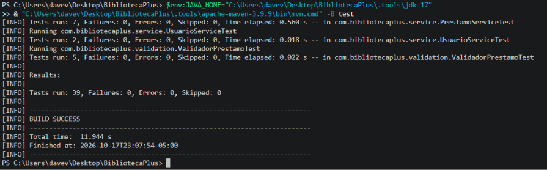
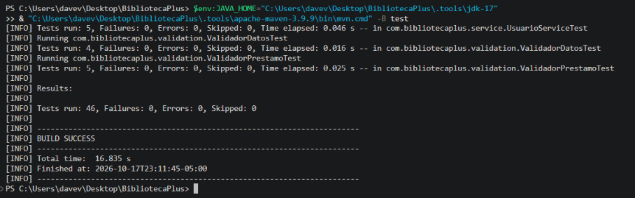
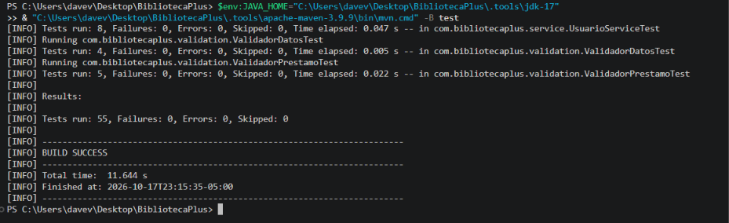

# RFC-010 · Validación de libros y usuarios

| Campo | Valor |
|---|---|
| Issue | [#10](https://github.com/nn-nnhub/BibliotecaPlus/issues/10) |
| Tipo de mantenimiento | Correctivo / Preventivo |
| Riesgo | Bajo (las validaciones pueden rechazar datos que antes se aceptaban) |
| Prioridad | Alta |
| Costo estimado | Medio |
| Responsable | Dave Villacorta |
| Fecha propuesta | 17/10/2026 |
| Etiquetas | RFC · Alta · Mejora |

## Relación con el RFC

La Issue #10 pide implementar y unificar las validaciones de libros y usuarios al registrar y actualizar: título y autor obligatorios, DNI de ocho dígitos y correo con formato válido, manteniendo intactos los registros existentes.

Dos cambios de este trabajo **no figuran en el texto de la Issue** y se identifican como **trabajo adicional**, pendiente de aprobación formal si se quiere ampliar el alcance:

| Hallazgo | Estado respecto a la Issue |
|---|---|
| H4a — validación de libros y disponibilidad | Cubierto por la Issue |
| H4b — formato de DNI y correo | Cubierto por la Issue |
| H8 — manejo de errores HTTP (400/404) | **Adicional**, no incluido en la Issue |
| H3 — bloqueo de la eliminación con préstamos | **Adicional**, no incluido en la Issue |

## Hallazgo

**H4a — libros.** Se guardaba un libro sin título ni autor o con `disponible=false`; `actualizar` aceptaba ISBN, título y autor vacíos. Además, un `PUT` sin el campo `disponible` marcaba como disponible un libro prestado, porque el objeto recibido toma el valor por defecto `true`.

**H4b — usuarios.** Se aceptaban DNI como `abc`, `7000000` o `700000012` y correos como `no-es-correo` o `carlos@`. Solo se comprobaba que los campos no estuvieran vacíos.

**H8 — errores HTTP.** Un libro o usuario inexistente respondía 400 en lugar de 404; `POST /api/prestamos` con un libro inexistente, `PUT /devolver` inexistente y un vencimiento pasado lanzaban una excepción sin manejar (500). Los manejadores de excepción estaban duplicados en dos controladores, `PrestamoController` no tenía ninguno y la violación de integridad devolvía siempre un mensaje fijo de ISBN o de DNI.

**H3 — eliminación.** `DELETE` de un libro o usuario con préstamos respondía 204 y dejaba el préstamo huérfano (los préstamos guardan solo `libroId` y `usuarioId`, sin clave foránea). `DELETE` de un id inexistente también respondía 204.

## Código anterior

`UsuarioService.validarUsuario` (solo comprueba que no estén vacíos):

```java
if (usuario == null || validadorDatos.estaVacio(usuario.getNombre())
        || validadorDatos.estaVacio(usuario.getApellidos())
        || validadorDatos.estaVacio(usuario.getDni())
        || validadorDatos.estaVacio(usuario.getCorreo())
        || validadorDatos.estaVacio(usuario.getTelefono())) {
    throw new IllegalArgumentException("Nombres, apellidos, DNI, correo y teléfono son obligatorios");
}
```

`LibroService.actualizar` y `eliminar`:

```java
libro.setTitulo(datosLibro.getTitulo());
libro.setAutor(datosLibro.getAutor());
libro.setIsbn(datosLibro.getIsbn());
libro.setDisponible(datosLibro.isDisponible());
return libroRepository.save(libro);
...
public void eliminar(Long id) {
    libroRepository.deleteById(id);
}
```

`LibroController` (manejadores duplicados en `UsuarioController` con el mensaje del DNI):

```java
@ExceptionHandler(DataIntegrityViolationException.class)
public ResponseEntity<Map<String, String>> manejarRestriccionUnica(DataIntegrityViolationException excepcion) {
    return ResponseEntity.badRequest().body(Map.of("message", "El ISBN ya está registrado en otro libro"));
}
```

## Solución aplicada

- **`ManejadorErrores.java`** (`@RestControllerAdvice`, nuevo): `RecursoNoEncontradoException` → 404; `IllegalArgumentException` → 400; `DataIntegrityViolationException` → 400 con mensaje de ISBN, de DNI o genérico según la causa. Se eliminaron los manejadores de `LibroController` y `UsuarioController`.
- **`RecursoNoEncontradoException.java`** (nueva): extiende `IllegalArgumentException`, por lo que no rompe el código existente.
- **`LibroService.java`**: `validarTituloYAutor` en `guardar` y `actualizar`, ISBN obligatorio al actualizar, `guardar` registra siempre el libro como disponible y `actualizar` ya no modifica `disponible`.
- **`ValidadorDatos.java` y `UsuarioService.java`**: `esDniValido` (exactamente 8 dígitos) y `esCorreoValido`, aplicados en `guardar` y `actualizar`. El teléfono no se valida porque no existe una regla documentada.
- **`PrestamoRepository.java`**: `existsByLibroId` y `existsByUsuarioId`.
- **`LibroService.eliminar` y `UsuarioService.eliminar`**: buscan primero (404) y rechazan si existen préstamos, activos o devueltos, para conservar el historial.

```java
private static final Pattern DNI = Pattern.compile("\\d{8}");
private static final Pattern CORREO = Pattern.compile("[^\\s@]+@[^\\s@]+\\.[^\\s@]+");
```

```java
public void eliminar(Long id) {
    Usuario usuario = buscarPorId(id);
    if (prestamoRepository.existsByUsuarioId(id)) {
        throw new IllegalArgumentException("No se puede eliminar el usuario porque tiene préstamos asociados");
    }
    usuarioRepository.delete(usuario);
}
```

## Evidencias visuales

Las capturas muestran la suite completa en verde tras cada cambio; no existen capturas de pruebas fallando. La evidencia real de los fallos previos se conserva como salida literal en [`evidencias/rfc-010-antes-despues.txt`](evidencias/rfc-010-antes-despues.txt).







## Resultado

- Se rechazan libros sin título o sin autor al registrar y al actualizar; el ISBN es obligatorio al actualizar.
- Un libro nuevo queda siempre disponible y actualizar un libro no cambia su disponibilidad.
- Se rechazan DNI que no tengan exactamente 8 dígitos y correos sin formato `algo@dominio.ext`, tanto al registrar como al actualizar.
- Los recursos inexistentes responden 404 y los errores de validación 400, con un mensaje JSON `{"message": ...}`.
- No se puede eliminar un libro o usuario con préstamos asociados; la eliminación de un id inexistente responde 404.

## Validación automatizada

Pruebas relevantes:

- `ValidacionLibrosHttpTest` (5) y `ValidacionUsuariosHttpTest` (5): contrato HTTP de las validaciones, incluida la conservación de la disponibilidad al actualizar.
- `LibroServiceTest` (10), `UsuarioServiceTest` (8) y `ValidadorDatosTest` (4): reglas de negocio y formatos.
- `ManejoErroresTest` (7) y `ManejadorErroresTest` (3): códigos 400 y 404 y mapeo de restricciones.
- `EliminacionConPrestamosTest` (3) y las pruebas de `eliminar` en los servicios: bloqueo y 404.

Comandos ejecutados (JDK 17 portable del proyecto):

```powershell
$env:JAVA_HOME="C:\Users\davev\Desktop\BibliotecaPlus\.tools\jdk-17"
& "C:\Users\davev\Desktop\BibliotecaPlus\.tools\apache-maven-3.9.9\bin\mvn.cmd" -B test
```

Resultados reales:

| Ejecución | Resultado |
|---|---|
| Código previo a RFC-010 (`76bf677`) con las cuatro clases de pruebas HTTP | 20 pruebas: 13 fallos y 3 errores |
| Código final, mismas clases | 20 pruebas, 0 fallos |
| Suite completa Java del código final | 81 pruebas, 0 fallos, `BUILD SUCCESS` |

El detalle de las ejecuciones archivadas está en `evidencias/rfc-010-antes-despues.txt`.

## Riesgos y limitaciones

- **Alcance:** H8 y H3 exceden el texto de la Issue #10; conviene ampliarla con aprobación formal o tratarlos como trabajo adicional.
- **HTTP 400 frente a 409:** el rechazo de eliminación con préstamos responde 400 por coherencia con las demás validaciones. Semánticamente sería 409 (Conflict); queda por decidir.
- **404 en préstamos:** `POST /api/prestamos` con un `libroId` o `usuarioId` inexistente ahora responde 404 (antes era una excepción sin manejar). Es un cambio de contrato que debe confirmarse.
- **Datos existentes:** no se modifica el esquema ni los registros. Los usuarios ya guardados con DNI o correo inválidos no se alteran, pero fallarán al actualizarlos. La validación no se ejecutó sobre la base real `./data`, que estaba abierta por la aplicación.
- **Interfaz:** no ofrece un botón para eliminar; el bloqueo solo se ejerce por la API.
- **Teléfono:** no se valida su formato por falta de una regla documentada.
