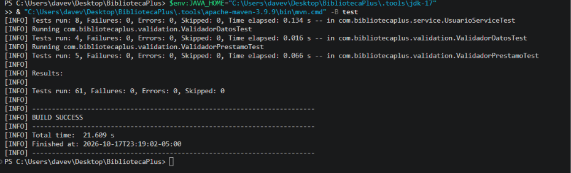
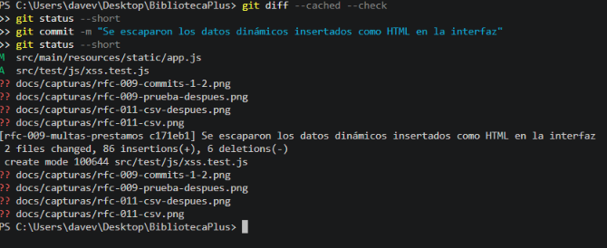

# RFC-011 · Seguridad y mejora de reportes

| Campo | Valor |
|---|---|
| Issue | [#11](https://github.com/nn-nnhub/BibliotecaPlus/issues/11) |
| Tipo de mantenimiento | Preventivo / Perfectivo |
| Riesgo | Medio |
| Prioridad | Media |
| Costo estimado | Medio |
| Responsable | Dave Villacorta |
| Fecha propuesta | 17/10/2026 |
| Etiquetas | RFC · Media · Mejora |

## Relación con el RFC

La Issue #11 pide corregir la inserción insegura de contenido dinámico en la interfaz, proteger el CSV frente a contenido peligroso, reducir las consultas repetidas de los reportes y revisar la configuración de H2 y del registro de SQL sin comprometer la persistencia de RFC-008.

| Hallazgo | Estado |
|---|---|
| H2 — XSS por `innerHTML` sin escapar | Corregido |
| H9 — CSV con fórmulas y separadores sin escapar | Corregido |
| H10 — consultas repetidas en los reportes | Corregido |
| H11 — `h2-console` y `show-sql` | Revisado y documentado; **sin cambios de configuración** |

## Hallazgo

**H2.** Título, autor, ISBN, nombres y demás datos se insertaban con `innerHTML` sin escapar. En la prueba, ``, `<script>…` y `"><svg onload=…>` llegaban intactos al HTML. Un libro con título nulo rompía además el filtro de búsqueda.

**H9.** El CSV exportaba `1;=HYPERLINK("x";"y");Ana Torres;…`: la fórmula quedaba intacta (inyección de fórmulas al abrirlo en Excel) y el `;` del título desplazaba las columnas.

**H10.** Con 6 préstamos, `listarPrestamos` ejecutaba 13 consultas (1 + 6 libros + 6 usuarios) y `generarResumen` ejecutaba 4, porque cada fila hacía su propio `findById`.

**H11.** La consola H2 está habilitada, `show-sql` está activo y el servidor no restringe su dirección de enlace. Se observó el comportamiento real (ver *Riesgos y limitaciones*).

## Código anterior

`app.js` (datos sin escapar en `innerHTML`):

```js
cuerpo.innerHTML = librosVisibles.map(libro => `<tr><td>${libro.id}</td><td>${libro.titulo}</td><td>${libro.autor}</td><td>${libro.isbn}</td>...
```

`ReporteController` (CSV armado a mano, sin escape):

```java
StringBuilder csv = new StringBuilder("ID;Libro;Usuario;Fecha préstamo;Fecha vencimiento;Devuelto;Multa\n");
filas.forEach(fila -> csv.append(fila.get("id")).append(';').append(fila.get("libro")).append(';')
        .append(fila.get("usuario")).append(';').append(fila.get("fechaPrestamo")).append(';')
        ...
```

`ReporteService` (una consulta por fila):

```java
fila.put("libro", libroRepository.findById(prestamo.getLibroId()).map(libro -> libro.getTitulo()).orElse("Libro " + prestamo.getLibroId()));
fila.put("usuario", usuarioRepository.findById(prestamo.getUsuarioId()).map(usuario -> (usuario.getNombre() + " " + usuario.getApellidos()).trim()).orElse("Usuario " + prestamo.getUsuarioId()));
```

## Solución aplicada

- **`app.js` (H2)**: la función `escaparHtml` convierte `& < > " '` y se aplica a todos los valores dinámicos de las cinco asignaciones a `innerHTML` (tabla y selector de libros, tabla y selector de usuarios, historial de préstamos). El identificador del botón "Devolver" pasa por `Number()` y el filtro de libros tolera valores nulos. Los mensajes de estado ya usaban `textContent`.
- **`ExportadorCsv.java` y `ReporteController.java` (H9)**: se antepone `'` a los textos que empiezan por `=`, `+`, `-`, `@`, tabulación o retorno de carro; se entrecomillan los valores con `;`, comillas o saltos de línea duplicando las comillas. Solo se neutralizan las cadenas, no los números. Se conservan el encabezado y el BOM UTF-8.
- **`ReporteService.java` (H10)**: los títulos de libro y los nombres de usuario se cargan **por lotes** con `findAllById` sobre los identificadores distintos, y se resuelven desde un mapa.

```java
private Map<Long, String> titulosDeLibros(Stream<Long> libroIds) {
    List<Long> ids = libroIds.filter(Objects::nonNull).distinct().toList();
    return libroRepository.findAllById(ids).stream()
            .filter(libro -> libro.getTitulo() != null)
            .collect(Collectors.toMap(Libro::getId, Libro::getTitulo));
}
```

Los resultados se conservan: los libros o usuarios ausentes (datos históricos) siguen mostrándose como `Libro N` y `Usuario N`.

## Evidencias visuales

Las capturas muestran resultados en verde; no existen capturas de pruebas fallando. La evidencia real de los fallos previos (incluida la fila `=HYPERLINK(...)` del CSV, los conteos 13 y 4 de consultas y las pruebas JavaScript en rojo) se conserva como salida literal en [`evidencias/rfc-011-antes-despues.txt`](evidencias/rfc-011-antes-despues.txt).






## Resultado

- Los datos controlados por el usuario se muestran como texto y no se interpretan como HTML ni JavaScript.
- El CSV escapa separadores, comillas y saltos de línea y neutraliza los valores que empiezan por caracteres de fórmula.
- Listar los préstamos del reporte necesita como máximo 3 consultas y el resumen 2, con independencia del número de filas.
- Los resultados de los reportes son equivalentes a los anteriores (pruebas de caracterización).

## Validación automatizada

Pruebas relevantes:

- `ExportacionCsvTest` (1) y `ExportadorCsvTest` (5): fórmulas, separadores, comillas, saltos de línea y estructura.
- `ReporteControllerTest` (2): contrato del resumen y del CSV (cabeceras, BOM y encabezado).
- `ReporteServiceTest` (4): dos pruebas de equivalencia y dos que cuentan las sentencias SQL con las estadísticas de Hibernate (`<= 3` y `<= 2`).
- `src/test/js/xss.test.js` (5), `escape.test.js` (3) y `prestamos.test.js` (2): `app.js` se ejecuta en un contexto `vm` de Node con un `document` simulado.

Comandos ejecutados (JDK 17 portable del proyecto):

```powershell
$env:JAVA_HOME="C:\Users\davev\Desktop\BibliotecaPlus\.tools\jdk-17"
& "C:\Users\davev\Desktop\BibliotecaPlus\.tools\apache-maven-3.9.9\bin\mvn.cmd" -B test
node --test "src/test/js/*.test.js"
```

Resultados reales:

| Ejecución | Resultado |
|---|---|
| `ExportacionCsvTest` con el código previo (`9863f4f`) | Falla: la fila exportada conserva `=HYPERLINK("x";"y")` |
| `ReporteServiceTest` con el código previo (`e1990a2`) | Fallan 2 de 4: "se ejecutaron 13" y "se ejecutaron 4" consultas |
| Pruebas JavaScript con el `app.js` previo (`9863f4f`) | 8 pruebas: 1 aprobada y 7 fallidas |
| Código final: CSV, reportes y controlador | 7 pruebas, 0 fallos |
| Suite completa Java del código final | 81 pruebas, 0 fallos, `BUILD SUCCESS` |
| Suite JavaScript del código final | 10 pruebas, 0 fallos |

El detalle de las ejecuciones archivadas está en `evidencias/rfc-011-antes-despues.txt`. **Las pruebas JavaScript no forman parte de `mvn test`**: se ejecutan por separado con Node.

## Riesgos y limitaciones

**H11 — revisión sin cambios.** Observaciones reales (aplicación en ejecución y una prueba con servidor aleatorio y base en memoria):

- La aplicación escucha en `0.0.0.0:8080` y `[::]:8080` (no se define `server.address`): la API, sin autenticación, es accesible desde la red local.
- `GET /h2-console/` responde 200. La consola está habilitada con `spring.h2.console.settings.web-allow-others=false` (valor por defecto observado en la prueba); según la documentación de H2, esa opción impide que equipos remotos usen la consola. No se probó una conexión remota.
- La base se abre con el usuario `sa` y contraseña vacía.
- `show-sql=true` y `format_sql=true` escriben cada sentencia en la salida estándar. Las sentencias llevan marcadores `?`, no los valores, así que el riesgo de filtrar datos es bajo; el costo es ruido y algo de rendimiento.

**Decisión:** no se modificó la configuración. El `README` documenta la consola H2 como funcionalidad prevista y RFC-008 depende de la persistencia local; desactivarla rompería el entorno de desarrollo. Queda pendiente decidir si, para un despliegue que no sea de desarrollo, conviene un perfil con consola deshabilitada, `show-sql=false`, `server.address=127.0.0.1` y contraseña para la base.

Otras limitaciones:

- **Apóstrofo en el CSV:** neutralizar con `'` cambia el texto visible de una celda que empiece por esos caracteres (se verá `'=…`). Es la práctica habitual; queda por decidir si se acepta.
- **Pruebas JavaScript:** el `document` es simulado; no se verificó el comportamiento en un navegador real y no existe una política de seguridad de contenido (CSP). No se comprobó la apertura del CSV en Excel con datos reales.
- **Conteo exacto de consultas:** las pruebas verifican los límites `<= 3` y `<= 2`; los conteos de 13 y 4 se midieron solo antes del cambio.
- **Base real:** nada se ejecutó sobre `./data`.
- **Fuera de alcance:** la atomicidad de las operaciones de préstamo y el control de concurrencia pertenecen a otros RFC; la prueba `ConcurrenciaPrestamosTest.java` queda sin seguimiento y sin incluir.
