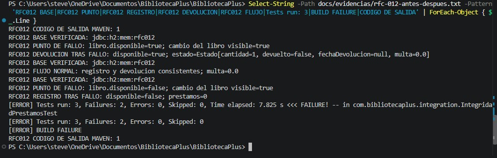
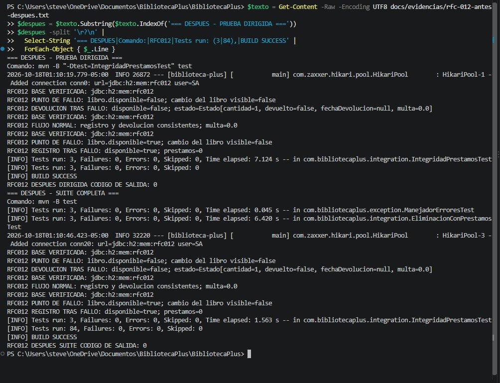

# RFC-012 · Integridad transaccional de préstamos y devoluciones

| Campo | Valor |
|---|---|
| Issue | [#12](https://github.com/nn-nnhub/BibliotecaPlus/issues/12) |
| Responsable | Stevens |
| Tipo | Preventivo / Correctivo |
| Prioridad / riesgo | Alta / Medio |
| Estado | Solución implementada; pruebas y capturas ANTES/DESPUÉS verificadas; commits restantes pendientes |
| Base de producción examinada | `0557ad36d161cfd7947313f56a9a0b28aed217a1` |
| Rama | `rfc-012-integridad-prestamos` |

La aprobación de Ethan fue comunicada por el usuario. El texto del Issue consultado aún indica pendiente de aprobación y no tiene comentarios. No se modificó el Issue.

## Metodología ANTES

Se agregó [IntegridadPrestamosTest](../src/test/java/com/bibliotecaplus/integration/IntegridadPrestamosTest.java), sin modificar archivos de producción. Usa el servicio administrado por Spring y repositorios JPA reales, con un espía únicamente en `PrestamoRepository.save` para provocar una excepción controlada antes de persistir el préstamo.

Configuración explícita: `jdbc:h2:mem:rfc012;DB_CLOSE_DELAY=-1`, `ddl-auto=create-drop`, consola H2 y open-in-view desactivados. Antes de preparar datos se verifica la URL JDBC efectiva y autocommit. Las ocho clases de integración preexistentes también declaran URLs `jdbc:h2:mem:`; la configuración de producción apunta a un archivo y no se utiliza en esta ejecución. Se ejecutó únicamente la clase nueva. No se abrió ni alteró `./data/bibliotecadb`.

Cada escenario crea su propio libro con ISBN único y utiliza un usuario de ejemplo del inicializador de la base en memoria. No se presupone ningún identificador fijo. La prueba no tiene `@Transactional` ni inicia servidor HTTP. Cada consulta de evidencia abre y cierra una conexión JDBC independiente, fuera del contexto JPA y del repositorio espiado. El espía se restablece automáticamente entre métodos por Spring Boot.

En el punto de fallo, una lectura JDBC independiente observa el cambio del libro ya confirmado; se imprime antes de lanzar `FalloControlado`. `assertThrows` comprueba la excepción exacta, y se verifica una sola llamada a `save`. Las consultas posteriores usan JDBC y siguen funcionando aunque ese método del repositorio esté intervenido. Las aserciones exigen atomicidad, sin adaptarse al comportamiento defectuoso.

Comando ejecutado:

```powershell
mvn -B "-Dtest=IntegridadPrestamosTest" test
```

La salida combinada se conservó con `Tee-Object` y se registró `$LASTEXITCODE`. El primer intento fue bloqueado antes de las pruebas por acceso a `C:\.m2\repository`. Se conserva ese diagnóstico al comienzo del registro. Tras autorizar la ejecución fuera del aislamiento, Maven ejecutó las tres pruebas. El bloqueo inicial no se cuenta como defecto del sistema.

## Resultados observados ANTES

| Escenario | Estado inicial | Estado persistido tras la operación | Resultado |
|---|---|---|---|
| Fallo en registro | Disponible, sin préstamos para el libro | No disponible, cero préstamos | Falla la aserción de disponibilidad: estado parcial |
| Fallo en devolución | No disponible; un préstamo activo, fecha de devolución nula y multa 0 | Disponible; el préstamo sigue activo, fecha nula y multa 0 | Falla la aserción de disponibilidad: estado parcial |
| Registro y devolución normales | Libro disponible | Registro: ocupado y préstamo activo. Devolución: disponible, préstamo devuelto con fecha de hoy y multa 0 | Pasa |

En los dos fallos controlados, `cambio del libro visible=true` confirma que una conexión independiente observó la primera escritura antes de que se intentara persistir el préstamo.

Resultado real: **3 pruebas, 2 fallos de aserción, 0 errores, 0 omitidas; BUILD FAILURE; código de salida 1**. Esto demuestra las inconsistencias bajo el fallo inyectado. No demuestra frecuencia de fallos reales ni comportamiento concurrente.

La salida de Maven informa `2026-10-18T00:53:32-05:00`; se conserva literalmente como marca del proceso. [Registro completo de ejecución](evidencias/rfc-012-antes-despues.txt). Los informes de Surefire se generaron en `target/surefire-reports` y pueden sobrescribirse en futuras ejecuciones.

## Captura ANTES

Se comprobó la captura real guardada como `docs/capturas/rfc-012-antes.jpg`. No existe `docs/capturas/rfc-012-antes.png`; se conserva el formato y nombre originales de la imagen recibida.



La captura muestra un extracto del registro de ejecución en la terminal: base `jdbc:h2:mem:rfc012`, registro fallido con libro no disponible y cero préstamos, devolución fallida con libro disponible y préstamo todavía activo, flujo normal correcto y Maven con 3 pruebas, 2 fallos, 0 errores y código de salida 1. Corresponde a la consulta del registro conservado, no a una nueva ejecución de las pruebas.

## Solución implementada y resultados DESPUÉS

Se añadió `org.springframework.transaction.annotation.Transactional` a los métodos públicos `registrar()` y `devolver()` de `PrestamoService`. Es el único archivo de producción modificado: una importación y dos anotaciones. No se modificaron las pruebas ni sus aserciones.

Las llamadas desde el controlador y desde la prueba al bean administrado atraviesan el proxy transaccional de Spring. Con propagación REQUIRED, las operaciones de repositorio participan en la misma transacción del servicio: se confirman juntas al terminar o se revierten ante RuntimeException o Error. La excepción controlada hereda de RuntimeException, por lo que no requiere `rollbackFor`. Los métodos actuales no declaran excepciones comprobadas; el comportamiento por defecto no garantiza rollback para futuras excepciones comprobadas. Spring Boot y JPA ya proporcionan el gestor de transacciones; no se añadieron dependencias ni configuración manual.

En DESPUÉS, el punto de fallo sigue siendo la llamada a `prestamoRepository.save`, después de `libroRepository.save`. JPA puede diferir la escritura SQL hasta el flush; el guardado del libro ya no confirma una transacción independiente. Las consultas JDBC ven el estado confirmado anterior (`cambio del libro visible=false`). Tras salir del servicio por la excepción, las lecturas independientes comprueban el estado conservado. No se ha debilitado ninguna aserción para obtener este resultado.

| Escenario | ANTES | DESPUÉS |
|---|---|---|
| Registro con fallo | Libro no disponible, cero préstamos | Libro disponible, cero préstamos |
| Devolución con fallo | Libro disponible, préstamo activo | Libro no disponible, préstamo activo; fecha de devolución nula y multa 0 |
| Registro y devolución normales | Correctos | Correctos; multa 0 para devolución a tiempo |

Ejecuciones reales sobre el commit base `1480992` con el cambio transaccional sin commit:

| Comando | Pruebas | Fallos / errores / omitidas | Resultado | Salida |
|---|---|---|---|---|
| `mvn -B "-Dtest=IntegridadPrestamosTest" test` | 3 | 0 / 0 / 0 | BUILD SUCCESS | 0 |
| `mvn -B test` | 84 | 0 / 0 / 0 | BUILD SUCCESS | 0 |

Las marcas del proceso son `2026-10-18T01:10:24-05:00` para la prueba dirigida y `2026-10-18T01:10:52-05:00` para la suite. Ambas salidas completas se anexaron al [archivo de evidencias](evidencias/rfc-012-antes-despues.txt), bajo los encabezados `DESPUES - PRUEBA DIRIGIDA` y `DESPUES - SUITE COMPLETA`. La evidencia ANTES se conservó íntegramente como prefijo del archivo.

Se volvió a revisar la configuración de todas las clases de integración: usan H2 en memoria. La prueba dirigida verifica `jdbc:h2:mem:rfc012` mediante metadatos JDBC y la suite registra únicamente conexiones `jdbc:h2:mem:`. No se abrió la base de producción `./data/bibliotecadb`. La suite Maven no ejecuta las pruebas JavaScript.

## Captura auténtica DESPUÉS

Se verificó el archivo real `docs/capturas/rfc-012-despues.jpg` y su contenido visual. El nombre y la extensión coinciden con este enlace relativo:



La captura muestra el extracto del registro conservado: H2 en memoria `jdbc:h2:mem:rfc012`, registro fallido con libro disponible y cero préstamos, devolución fallida con libro ocupado y préstamo activo, flujo normal correcto, 3 pruebas específicas y 84 de la suite completa sin fallos ni errores. Ambas ejecuciones terminaron con BUILD SUCCESS y código 0. La captura ANTES enlazada arriba conserva las 3 pruebas con 2 fallos y código 1.

## Alcance y seguimiento

La atomicidad comprobada abarca las escrituras de la base de datos. La notificación actual se invoca dentro del método de registro; una transacción de base de datos no revierte efectos externos de notificaciones. No se rediseñó ese mecanismo. Tampoco se implementa control de concurrencia (RFC-013) ni filtros (RFC-014), ni se cambian las tarifas de RFC-009 o la persistencia local de RFC-008.

Se conserva la meta de 30 commits propios en total y la distribución inicial aproximada de 10 por RFC, ajustable a avances reales. El [registro de commits](registro-commits-rfc-012-014.md) confirma `1480992` (pruebas ANTES) y `11fc483` (corrección transaccional): acumulado **2 de 30**. La documentación y evidencia DESPUÉS están preparadas como tercer commit, pendiente de autorización y creación; no se ejecutaron push ni PR.
