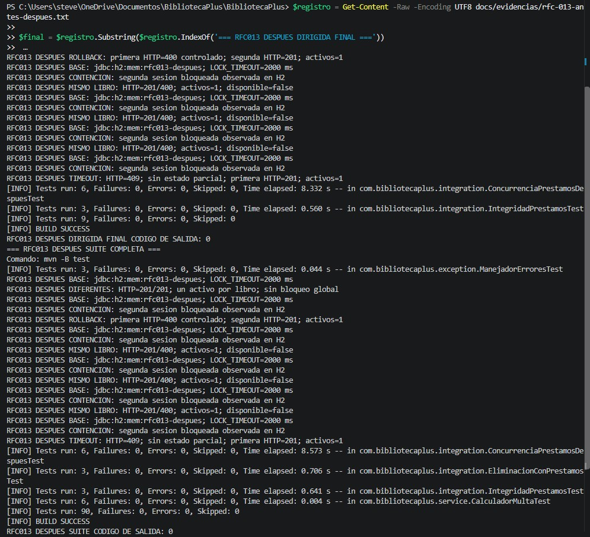
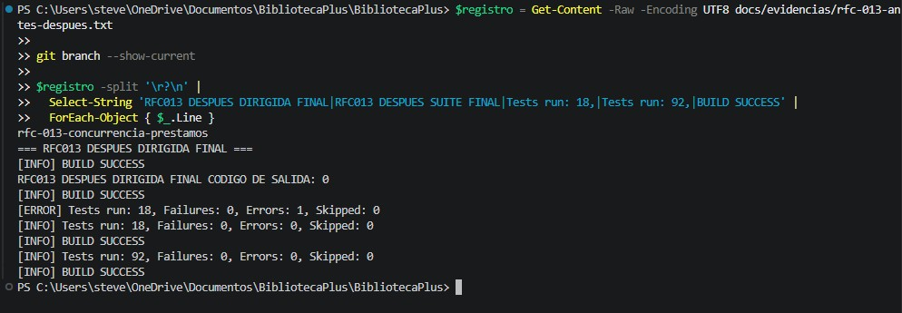

# RFC-013 · Control de concurrencia en préstamos simultáneos

| Campo | Valor |
|---|---|
| Issue | [#13](https://github.com/nn-nnhub/BibliotecaPlus/issues/13) |
| Responsable | Stevens |
| Tipo / prioridad / riesgo | Preventivo-Correctivo / Alta / Medio |
| Estado | Solución implementada; HTTP 409 delimitado; pruebas DESPUÉS aprobadas y captura histórica verificada |
| Rama | `rfc-013-concurrencia-prestamos` |
| Base | `b710fdb`, extremo de `rfc-012-integridad-prestamos` al crear la rama |
| Dependencia | RFC-012, PR #20 aún sin fusionar según el usuario |

## Alcance y requisitos revisados

El Issue completo pide reproducir solicitudes simultáneas, permitir como máximo un préstamo activo del mismo libro, responder de forma controlada al rechazo, evitar estados parciales, justificar el mecanismo elegido, conservar préstamos de libros diferentes, compatibilidad H2 e historial y guardar pruebas y capturas. Depende de las transacciones de RFC-012.

El Issue consultado aún dice «Propuesta pendiente de revisión y aprobación. No implementada». El usuario autorizó expresamente esta fase de preparación y pruebas ANTES; no se interpreta como autorización para implementar producción. No se modificó el Issue.

La rama se creó desde RFC-012 después de comprobar que solo `AGENTS.md` estaba sin seguimiento. No se cambió `main`. Mientras RFC-012 no esté fusionado, esta rama incluye sus cuatro commits heredados; no son cuatro commits adicionales de RFC-013. Acumulado real al preparar esta fase: **4 de 30 commits propios**, todos de RFC-012. No se creó ningún commit en esta fase.

## Análisis del código actual

`PrestamoService.registrar()` ya tiene `@Transactional` de RFC-012: lee el libro con `findById`, comprueba disponibilidad, valida, modifica el libro y guarda un préstamo. La atomicidad no impide por sí sola que dos transacciones lean simultáneamente `disponible=true`.

`LibroRepository` hereda el `findById` de JPA sin bloqueo explícito. `Libro` no tiene `@Version`. La restricción única existente afecta al ISBN, no a los préstamos activos. `Prestamo` guarda `libroId` y `usuarioId`; `PrestamoRepository` no incorpora una exclusión de préstamos activos duplicados.

## Metodología ANTES

Se añadió [ConcurrenciaPrestamosTest](../src/test/java/com/bibliotecaplus/integration/ConcurrenciaPrestamosTest.java). No se modificaron producción, las pruebas ni los documentos y evidencias de RFC-012.

- H2 exclusivamente en memoria: `jdbc:h2:mem:rfc013;DB_CLOSE_DELAY=-1;LOCK_TIMEOUT=5000`, esquema `create-drop`, consola H2 desactivada. Antes de preparar cada escenario se exige por metadatos JDBC la URL exacta `jdbc:h2:mem:rfc013` y autocommit. No se accede a `./data/bibliotecadb`.
- Cada escenario crea libros con ISBN único y obtiene dos usuarios del inicializador de esa base aislada, sin IDs fijos.
- Dos hilos llaman al bean del servicio administrado por Spring. Cada llamada abre su propia transacción de RFC-012; la prueba principal no está envuelta en una transacción.
- Un espía de `ValidadorPrestamo.validar` ejecuta la validación real y espera en una `CyclicBarrier(2)`, después de que cada llamada haya leído y comprobado el libro como disponible, antes de escribirlo. Se verifica que cada hilo tenga una transacción activa y un libro disponible. No se sustituyen lecturas ni escrituras de repositorio.
- La barrera no deja avanzar a ningún hilo hasta que ambos hayan alcanzado ese punto. No hay pausas aleatorias. Tiene límite de 10 segundos; los futuros esperan hasta 30 segundos y el ejecutor se cierra en `finally`.
- Se acepta como rechazo controlado únicamente `IllegalArgumentException` del servicio. Fallos de barrera, SQL o infraestructura no se cuentan como rechazos correctos.
- Una vez que ambos futuros terminan y las transacciones han concluido, el hilo principal consulta con JDBC los préstamos activos y la disponibilidad. Esas consultas son independientes de las entidades JPA de los trabajadores.
- Mismo libro: tres repeticiones con libro nuevo en cada una. Se exige un éxito, un rechazo y un único préstamo activo. Libros diferentes: se exigen dos éxitos, un préstamo activo por libro y ambos libros ocupados.

Comando real:

```powershell
mvn -B "-Dtest=ConcurrenciaPrestamosTest" test
```

## Resultados observados ANTES

| Escenario | Ejecuciones | Observación persistida | Resultado |
|---|---|---|---|
| Dos solicitudes al mismo libro | 3 | En cada repetición: 2 éxitos, 2 préstamos activos, libro no disponible | Fallan las aserciones de exclusión y unicidad |
| Dos solicitudes a libros diferentes | 1 | 2 éxitos, 1 préstamo activo por libro, ambos no disponibles | Pasa |

La carrera está reproducida bajo una intercalación coordinada: ambas llamadas superan la comprobación de disponibilidad antes de escribir. Esto muestra que las transacciones de RFC-012 aseguran atomicidad individual, pero no exclusión entre préstamos concurrentes.

La línea del informe de clase y el XML de Surefire registran **4 ejecuciones, 3 fallos, 0 errores y 0 omitidas**. El resumen final de Maven agrupa las tres repeticiones bajo el mismo método y muestra literalmente **Tests run: 2, Failures: 1, Errors: 0, Skipped: 0**, con `Run 1`, `Run 2` y `Run 3` fallidos. Se conservan ambos conteos; no son ejecuciones distintas. Resultado: **BUILD FAILURE, código de salida 1**. Marca de finalización del proceso: `2026-10-18T01:32:00-05:00`.

[Salida real completa](evidencias/rfc-013-antes-despues.txt). No se ejecutó la suite completa en esta fase; la ejecución dirigida demuestra el fallo buscado. El informe temporal de Surefire puede sobrescribirse en ejecuciones futuras; la salida guardada contiene también el conteo por clase.

## Captura auténtica ANTES

Se verificó la imagen real `docs/capturas/rfc-013-antes.jpg`, incluida su extensión y su contenido visual.


La captura muestra la rama `rfc-013-concurrencia-prestamos`, la base `jdbc:h2:mem:rfc013`, tres repeticiones con dos éxitos y dos préstamos activos para el mismo libro, y el escenario correcto de libros diferentes. También muestra el informe de 4 ejecuciones individuales con 3 fallos, el resumen Maven de 2 pruebas con 1 fallo y BUILD FAILURE con código de salida 1. Corresponde a un extracto del registro de ejecución conservado, no a una nueva ejecución.

## Solución implementada DESPUÉS

Se añadió una consulta JPQL específica `LibroRepository.buscarPorIdConBloqueo(id)` con `@Lock(PESSIMISTIC_WRITE)`. `PrestamoService.registrar()` la usa antes de comprobar disponibilidad, conservando `@Transactional` del RFC-012. H2 ejecuta `SELECT ... FOR UPDATE`: el primer registro mantiene el bloqueo hasta commit o rollback y el siguiente comprueba la disponibilidad después de adquirirlo. No se cambiaron las entidades, el esquema, los IDs ni las tarifas.

Se eligió bloqueo por fila para evitar migraciones de columnas de versión y mantener la decisión de disponibilidad dentro de la transacción existente. Los libros diferentes no comparten ese bloqueo. La consulta normal `findById` se conserva para otros usos.

La segunda solicitud que encuentra el libro ocupado recibe la `IllegalArgumentException` ya existente, traducida a HTTP 400 con el mensaje «El libro no está disponible». Se conserva ese contrato. El manejador global devuelve HTTP 409 únicamente para `ConflictoBloqueoLibroException`. El servicio convierte `PessimisticLockingFailureException` o `QueryTimeoutException` a esa excepción específica exclusivamente alrededor de `buscarPorIdConBloqueo`, conservando la causa. Errores de otras consultas, guardados o commit no se convierten en conflictos de libro; no se expone SQL al cliente. La excepción específica hereda de RuntimeException y mantiene el rollback transaccional.

Las conexiones Hikari ejecutan `SET LOCK_TIMEOUT 2000` al crearse. Es un límite H2 de espera por adquisición, no un plazo total de toda solicitud ni de la transacción. Se comprueba el valor efectivo con `CALL LOCK_TIMEOUT()` en las pruebas. La configuración no abre ni modifica el esquema de la base local durante estas ejecuciones.

### Problema real encontrado al vencer el bloqueo

Con H2 2.2.224 y Hikari del proyecto, el timeout de bloqueo (`50200`, SQLState `HYT00`) hacía que Hikari expulsara la conexión antes del rollback JPA. El error final pasaba a ser `JpaSystemException: Unable to rollback against JDBC Connection`, ocultando el rechazo previsto.

Se añadió `H2LockTimeoutOverride`, registrado mediante `spring.datasource.hikari.exception-override-class-name`, para impedir la expulsión **únicamente** cuando coinciden ese código y SQLState. El timeout de fila no invalida esa conexión y JPA puede completar su rollback. Los demás errores siguen la decisión normal de Hikari. La prueba de timeout reproduce el fallo real de base de datos y ahora exige HTTP 409 y estado sin cambios mientras la primera solicitud sigue retenida.

La primera validación DESPUÉS también detectó dos problemas del arnés nuevo: comparación de un mensaje UTF-8 con decodificación incorrecta y una delegación `callRealMethod` no válida sobre un método abstracto del repositorio. Se corrigieron usando decodificación UTF-8 y delegación al guardado real `saveAndFlush` para la segunda solicitud del escenario de fallo. Un intento intermedio encontró un conflicto de nombres entre `@Override` y el enum `SQLExceptionOverride.Override`, corregido con `@java.lang.Override`. Todas las salidas fallidas se conservaron antes de las ejecuciones finales aprobadas.

## Prueba DESPUÉS y conservación de ANTES

Nueva clase: [ConcurrenciaPrestamosDespuesTest](../src/test/java/com/bibliotecaplus/integration/ConcurrenciaPrestamosDespuesTest.java), con llamadas HTTP concurrentes mediante MockMvc y base `jdbc:h2:mem:rfc013-despues`. No necesita servidor ni datos locales.

La primera solicitud se retiene después de adquirir su bloqueo, usando dos `CountDownLatch` con límites. Antes de liberar el primer hilo, se verifica que H2 muestra una segunda sesión bloqueada en `INFORMATION_SCHEMA.SESSIONS.BLOCKER_ID`, mediante espera condicionada acotada; no se usan pausas aleatorias. Los futuros tienen plazos y los ejecutores se cierran en `finally`.

El control de libros diferentes exige que el segundo préstamo termine mientras el primero sigue retenido. La prueba de timeout mantiene el primer bloqueo hasta que la segunda solicitud responde 409. La de fallo de persistencia hace fallar el primer `save` de préstamo y verifica que la solicitud en espera puede adquirir el libro y registrarlo. Las consultas de estado posteriores son JDBC independientes de las transacciones de las solicitudes.

La prueba ANTES `ConcurrenciaPrestamosTest.java` queda **intacta**. Su barrera posterior a la lectura es incompatible con la exclusión pesimista: el segundo hilo no puede llegar a ella mientras el primero conserva el bloqueo. Por eso `pom.xml` excluye exclusivamente esa clase del descubrimiento automático de Surefire; las seis ejecuciones DESPUÉS sustituyen su cobertura activa. No se debe ejecutar esa clase contra la solución para evaluar el bloqueo: es un arnés de reproducción del código ANTES. Para reproducir ANTES hay que usar el código del commit `5e64e17` en un entorno aislado, sin retroceder esta rama.

Hashes SHA-256 originales:

- Prueba ANTES: `B08514CE0B6C970270F18493BDC4892AEF3E4EC9A020FF9BB4A5A747D17B708C`.
- Evidencia ANTES completa, antes de anexar DESPUÉS: `8B5B2852DA7739C0C3E14F39E105892B61AB4EA2F471603C84B01ADE0C9F7977`.

La evidencia original se conserva byte a byte como prefijo del archivo ampliado; el hash del archivo completo cambia al anexar las nuevas salidas. No se retocan ni se reemplazan los resultados ANTES.

## Resultados reales DESPUÉS

| Escenario | Ejecuciones | Resultado observado |
|---|---|---|
| Mismo libro con espera de bloqueo real | 3 | HTTP 201 y 400; un préstamo activo, libro ocupado |
| Libros diferentes | 1 | HTTP 201 y 201; un activo por libro; el segundo termina antes de liberar el primero |
| Timeout H2 de 2000 ms | 1 | Segunda HTTP 409; cero préstamos y disponibilidad intacta antes del commit de la primera; después un activo |
| Fallo controlado al guardar el primer préstamo | 1 | Primera HTTP 400 por fallo inyectado; segunda HTTP 201; un solo activo |
| Regresión RFC-012 | 3 | Rollback en registro y devolución y flujo normal correctos |

| Comando | Pruebas | Fallos / errores / omitidas | Resultado / salida |
|---|---|---|---|
| `mvn -B "-Dtest=ConcurrenciaPrestamosDespuesTest,IntegridadPrestamosTest" test` | 9 | 0 / 0 / 0 | BUILD SUCCESS / 0 |
| `mvn -B test` | 90 | 0 / 0 / 0 | BUILD SUCCESS / 0 |

Las seis ejecuciones DESPUÉS se cuentan individualmente en estas ejecuciones aprobadas. El arnés ANTES excluido no se suma ni se presenta como aprobado. La suite conserva las 84 pruebas previas y añade seis; no ejecuta pruebas JavaScript. Las marcas finales del proceso son `2026-10-18T01:42:48-05:00` y `2026-10-18T01:43:24-05:00`.

Todas las clases de integración usan URLs H2 en memoria. `IntegridadPrestamosTest.java`, los documentos, las capturas y las evidencias de RFC-012 no se modificaron. Fue necesario cambiar un único stub de `PrestamoServiceTest.prepararRegistro()` a la nueva consulta; sus aserciones y el flujo de devolución permanecen iguales. El servicio y el manejador compartidos se modificaron únicamente para implementar el RFC-013.

## Revisión final del alcance HTTP 409

Se añadieron dos pruebas a `PrestamoServiceTest`: los dos tipos de fallo al adquirir el bloqueo conservan su causa dentro de `ConflictoBloqueoLibroException`; un timeout al consultar el usuario mantiene la excepción original y no se etiqueta como conflicto del libro. La integración HTTP con timeout H2 real vuelve a comprobar el 409 específico y el rollback. No hay un manejador global para todas las QueryTimeoutException ni para todas las RuntimeException.

El primer intento de esta revisión tuvo 18 pruebas, 0 fallos y 1 error al reconfigurar un mock dentro de un bucle: `when(...).thenThrow(...)` ejecutaba el stub previo al preparar el siguiente caso. Se corrigió con `doThrow(...).when(...)`; el intento se conserva íntegro en la evidencia. No se modificó el arnés ANTES.

Resultados finales, posteriores a las ejecuciones históricas de 9 y 90 pruebas descritas arriba:

| Comando | Pruebas | Fallos / errores / omitidas | Resultado / salida |
|---|---|---|---|
| `mvn -B "-Dtest=ConcurrenciaPrestamosDespuesTest,IntegridadPrestamosTest,PrestamoServiceTest" test` | 18 | 0 / 0 / 0 | BUILD SUCCESS / 0 |
| `mvn -B test` | 92 | 0 / 0 / 0 | BUILD SUCCESS / 0 |

La dirigida contiene 6 ejecuciones de concurrencia DESPUÉS, 3 de integridad RFC-012 y 9 unitarias del servicio. La suite completa aumenta de 90 a 92 por las dos pruebas nuevas de alcance. Las marcas del proceso son `2026-10-18T01:51:26-05:00` y `2026-10-18T01:51:54-05:00`. Las salidas se anexaron bajo `RFC013 REVISION HTTP409 DIRIGIDA FINAL` y `RFC013 REVISION HTTP409 SUITE COMPLETA` en el [registro completo](evidencias/rfc-013-antes-despues.txt).

La configuración Hikari sigue siendo necesaria en producción y pruebas H2: espera de bloqueo de 2000 ms por conexión y excepción de expulsión solo para el timeout H2 50200/HYT00, permitiendo el rollback. La configuración Surefire afecta el descubrimiento automático de pruebas, no el comportamiento de producción: excluye únicamente la clase ANTES conservada, sustituida por seis ejecuciones DESPUÉS. Un XML antiguo de esa clase puede permanecer en `target/surefire-reports`; no debe sumarse al informe de la ejecución nueva. Todas las integraciones de la ejecución final registran conexiones H2 en memoria.

## Captura auténtica DESPUÉS

Se comprobó la existencia y el contenido visual de `docs/capturas/rfc-013-despues.jpg`.



La imagen es evidencia auténtica de la ejecución histórica de 9 pruebas dirigidas y 90 de suite, anterior a la delimitación del HTTP 409. Muestra bloqueo, rollback, timeout 409 y ambos BUILD SUCCESS. Se conserva sin retocar y no se presenta como captura de las nuevas ejecuciones de 18 y 92 pruebas, cuyos resultados están en el archivo de evidencia.

### Captura de la revisión final: 18/92 pruebas

Se verificó la existencia y el contenido visual de `docs/capturas/rfc-013-despues-final.jpg`.



La imagen muestra la rama RFC-013 y un extracto del registro completo. Incluye el intento intermedio de 18 pruebas con 1 error de preparación del mock, seguido por los resultados finales de **18 y 92 pruebas, 0 fallos y 0 errores, BUILD SUCCESS**. Ese intento fallido se conserva como parte de la trazabilidad y no se presenta como aprobado. El extracto también incluye líneas de la validación anterior; la tabla de revisión final y las secciones del archivo de evidencia identifican los comandos y códigos de salida 0 correspondientes a las ejecuciones finales. Ambas capturas se conservan sin retocar.

## Limitaciones y seguimiento

La exclusión garantiza el flujo de registro a través de este servicio; no añade una restricción de unicidad en base de datos para escrituras externas que lo omitan. No corrige duplicados previos. La devolución simultánea del mismo préstamo y otras carreras de edición/eliminación quedan fuera de los escenarios verificados aquí. Los bloqueos deben mantenerse cortos; la notificación actual solo escribe un log pero se ejecuta antes del commit. El tiempo de espera y el adaptador Hikari son específicos del entorno H2 actual y deben revisarse al cambiar de motor o versiones.

La compatibilidad histórica se preserva por ausencia de cambios de entidades/esquema y por la regresión existente, no por haber abierto una copia de la base real ni ejecutado una migración sobre ella. No se accedió a `./data/bibliotecadb`. No se modificaron multas. La rama hereda RFC-012 y su integración con main sigue dependiendo de PR #20; no se hizo merge ni rebase.

La implementación y pruebas DESPUÉS están registradas en `e672594`. Fotografía histórica al cierre de ese commit: cuatro commits RFC-012, `5e64e17` (ANTES RFC-013) y `e672594` (corrección funcional RFC-013), **6 de 30 commits propios**. La documentación y evidencia DESPUÉS siguen pendientes de commit. No se ejecutó push ni se abrió PR en esta fase.
