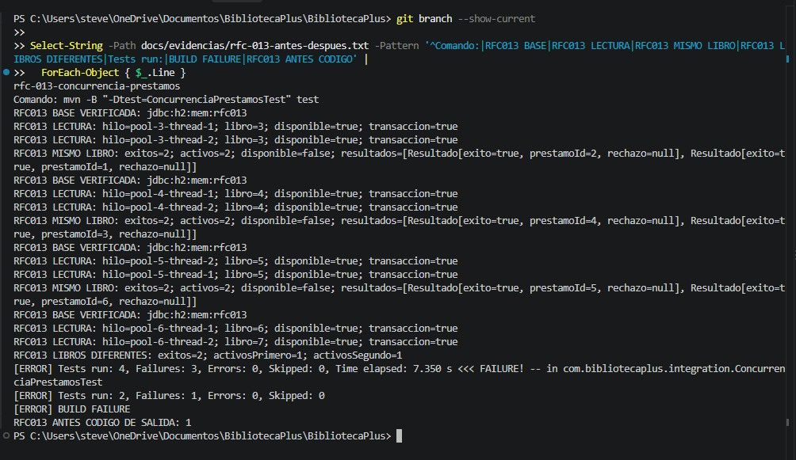

# RFC-013 · Control de concurrencia en préstamos simultáneos

| Campo | Valor |
|---|---|
| Issue | [#13](https://github.com/nn-nnhub/BibliotecaPlus/issues/13) |
| Responsable | Stevens |
| Tipo / prioridad / riesgo | Preventivo-Correctivo / Alta / Medio |
| Estado | Prueba y captura ANTES verificadas; solución no implementada |
| Rama | `rfc-013-concurrencia-prestamos` |
| Base | `b710fdb`, extremo de `rfc-012-integridad-prestamos` al crear la rama |
| Dependencia | RFC-012, PR #20 aún sin fusionar según el usuario |

## Alcance y requisitos revisados

El Issue completo pide reproducir solicitudes simultáneas, permitir como máximo un préstamo activo del mismo libro, responder de forma controlada al rechazo, evitar estados parciales, justificar el mecanismo elegido, conservar préstamos de libros diferentes, compatibilidad H2 e historial y guardar pruebas y capturas. Depende de las transacciones de RFC-012.

El Issue consultado aún dice «Propuesta pendiente de revisión y aprobación. No implementada». El usuario autorizó expresamente esta fase de preparación y pruebas ANTES; no se interpreta como autorización para implementar producción. No se modificó el Issue.

La rama se creó desde RFC-012 después de comprobar que solo `AGENTS.md` estaba sin seguimiento. No se cambió `main`. Mientras RFC-012 no esté fusionado, esta rama incluye sus cuatro commits heredados; no son cuatro commits adicionales de RFC-013. Acumulado real al preparar esta fase: **4 de 30 commits propios**, todos de RFC-012. No se creó ningún commit en esta fase.

## Análisis del código actual

`PrestamoService.registrar()` ya tiene `@Transactional` de RFC-012: lee el libro con `findById`, comprueba disponibilidad, valida, modifica el libro y guarda un préstamo. La atomicidad no impide por sí sola que dos transacciones lean simultáneamente `disponible=true`.

`LibroRepository` hereda el `findById` de JPA sin bloqueo explícito. `Libro` no tiene `@Version`. La restricción única existente afecta al ISBN, no a los préstamos activos. `Prestamo` guarda `libroId` y `usuarioId`; `PrestamoRepository` no incorpora una exclusión de préstamos activos duplicados.

## Metodología ANTES

Se añadió [ConcurrenciaPrestamosTest](../src/test/java/com/bibliotecaplus/integration/ConcurrenciaPrestamosTest.java). No se modificaron producción, las pruebas ni los documentos y evidencias de RFC-012.

- H2 exclusivamente en memoria: `jdbc:h2:mem:rfc013;DB_CLOSE_DELAY=-1;LOCK_TIMEOUT=5000`, esquema `create-drop`, consola H2 desactivada. Antes de preparar cada escenario se exige por metadatos JDBC la URL exacta `jdbc:h2:mem:rfc013` y autocommit. No se accede a `./data/bibliotecadb`.
- Cada escenario crea libros con ISBN único y obtiene dos usuarios del inicializador de esa base aislada, sin IDs fijos.
- Dos hilos llaman al bean del servicio administrado por Spring. Cada llamada abre su propia transacción de RFC-012; la prueba principal no está envuelta en una transacción.
- Un espía de `ValidadorPrestamo.validar` ejecuta la validación real y espera en una `CyclicBarrier(2)`, después de que cada llamada haya leído y comprobado el libro como disponible, antes de escribirlo. Se verifica que cada hilo tenga una transacción activa y un libro disponible. No se sustituyen lecturas ni escrituras de repositorio.
- La barrera no deja avanzar a ningún hilo hasta que ambos hayan alcanzado ese punto. No hay pausas aleatorias. Tiene límite de 10 segundos; los futuros esperan hasta 30 segundos y el ejecutor se cierra en `finally`.
- Se acepta como rechazo controlado únicamente `IllegalArgumentException` del servicio. Fallos de barrera, SQL o infraestructura no se cuentan como rechazos correctos.
- Una vez que ambos futuros terminan y las transacciones han concluido, el hilo principal consulta con JDBC los préstamos activos y la disponibilidad. Esas consultas son independientes de las entidades JPA de los trabajadores.
- Mismo libro: tres repeticiones con libro nuevo en cada una. Se exige un éxito, un rechazo y un único préstamo activo. Libros diferentes: se exigen dos éxitos, un préstamo activo por libro y ambos libros ocupados.

Comando real:

```powershell
mvn -B "-Dtest=ConcurrenciaPrestamosTest" test
```

## Resultados observados ANTES

| Escenario | Ejecuciones | Observación persistida | Resultado |
|---|---|---|---|
| Dos solicitudes al mismo libro | 3 | En cada repetición: 2 éxitos, 2 préstamos activos, libro no disponible | Fallan las aserciones de exclusión y unicidad |
| Dos solicitudes a libros diferentes | 1 | 2 éxitos, 1 préstamo activo por libro, ambos no disponibles | Pasa |

La carrera está reproducida bajo una intercalación coordinada: ambas llamadas superan la comprobación de disponibilidad antes de escribir. Esto muestra que las transacciones de RFC-012 aseguran atomicidad individual, pero no exclusión entre préstamos concurrentes.

La línea del informe de clase y el XML de Surefire registran **4 ejecuciones, 3 fallos, 0 errores y 0 omitidas**. El resumen final de Maven agrupa las tres repeticiones bajo el mismo método y muestra literalmente **Tests run: 2, Failures: 1, Errors: 0, Skipped: 0**, con `Run 1`, `Run 2` y `Run 3` fallidos. Se conservan ambos conteos; no son ejecuciones distintas. Resultado: **BUILD FAILURE, código de salida 1**. Marca de finalización del proceso: `2026-10-18T01:32:00-05:00`.

[Salida real completa](evidencias/rfc-013-antes-despues.txt). No se ejecutó la suite completa en esta fase; la ejecución dirigida demuestra el fallo buscado. El informe temporal de Surefire puede sobrescribirse en ejecuciones futuras; la salida guardada contiene también el conteo por clase.

## Captura auténtica ANTES

Se verificó la imagen real `docs/capturas/rfc-013-antes.jpg`, incluida su extensión y su contenido visual.



La captura muestra la rama `rfc-013-concurrencia-prestamos`, la base `jdbc:h2:mem:rfc013`, tres repeticiones con dos éxitos y dos préstamos activos para el mismo libro, y el escenario correcto de libros diferentes. También muestra el informe de 4 ejecuciones individuales con 3 fallos, el resumen Maven de 2 pruebas con 1 fallo y BUILD FAILURE con código de salida 1. Corresponde a un extracto del registro de ejecución conservado, no a una nueva ejecución.

## Pendientes para DESPUÉS

No se eligió ni implementó todavía un mecanismo de exclusión. Evaluar y justificar bloqueo optimista, pesimista u otra alternativa, incluida la respuesta HTTP controlada al rechazado. Esta fase prueba llamadas concurrentes al servicio, no solicitudes HTTP ni su código de respuesta.

La barrera actual fuerza que ambos hilos hayan leído disponibilidad; si se adopta un bloqueo pesimista previo a esa lectura, habrá que adaptar la coordinación para evitar esperar en una barrera que el segundo hilo no puede alcanzar mientras el primero retiene el bloqueo. Se conservarán la evidencia ANTES y las exigencias de un solo préstamo, ausencia de estados parciales y funcionamiento con libros diferentes. No interpretar un timeout del arnés como rechazo de negocio válido.

Después de autorizar implementación: verificar la respuesta controlada, consistencia, compatibilidad histórica, repetir concurrencia, ejecutar regresión y suite completa, y guardar evidencia y captura DESPUÉS. La integración de ramas debe considerar que PR #20 está pendiente; no se hará merge o rebase sin autorización.
