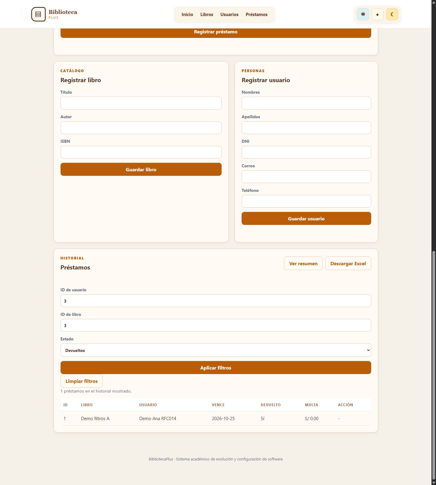
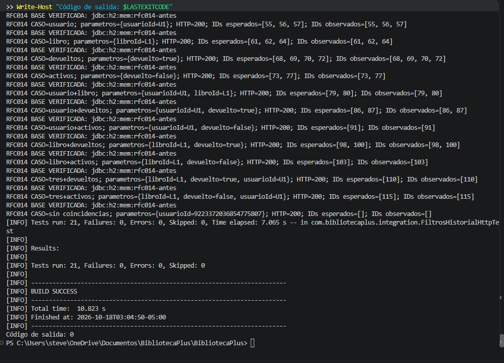

# RFC-014 · Búsqueda y filtrado del historial de préstamos

| Campo | Valor |
|---|---|
| Issue | [#14](https://github.com/nn-nnhub/BibliotecaPlus/issues/14) |
| Responsable | Stevens |
| Tipo / prioridad / riesgo | Perfectivo / Media / Bajo-Medio |
| Rama | `rfc-014-filtros-historial` |
| Base | `7b51b3648652777139b2debf8ff41ea31d7c4e95` (`origin/main`) |
| Estado | Filtros implementados; pruebas DESPUÉS aprobadas y cuatro capturas verificadas |

El usuario autorizó inicialmente la fase ANTES y, después del commit `a87c0aa`, la implementación y validación DESPUÉS sin crear commits. El texto del Issue consultado todavía figura como propuesta pendiente de aprobación. No se modificó el Issue.

La base incorpora RFC-012. La rama no hereda los cuatro commits exclusivos del RFC-013 ni su configuración de bloqueo/Surefire; el PR #21 no se modificó. Fotografía del trabajo previo a esta fase: **8 de 30 commits propios** entre los tres RFC. Esta fotografía corresponde al momento anterior al primer commit RFC-014; tras a87c0aa y d87a32b, el acumulado histórico es 10 de 30.

## Diagnóstico del código actual

`PrestamoController.listarTodos()` no declara parámetros. Invoca `PrestamoService.listarTodos()` y este llama a `PrestamoRepository.findAll()`. Los parámetros enviados no participan en la consulta. `app.js` carga el historial completo en `estado.prestamos` y `mostrarPrestamos()` dibuja todas sus filas. `index.html` no contiene controles de usuario, libro o devolución para el historial.

La tabla sí permite devolver préstamos y ofrece resumen y CSV, que deben mantener su comportamiento. La tarjeta global `totalPrestamos` se actualiza con la longitud del historial: el futuro filtrado no debe convertir ese total global en un conteo de coincidencias.

## Contrato propuesto para DESPUÉS

- `GET /api/prestamos` sin parámetros: misma respuesta JSON y alcance completo.
- `usuarioId` y `libroId`: IDs positivos representables como Long; coincidencia exacta. IDs válidos sin registros coincidentes producen `[]`, no 404.
- `devuelto=true`: devueltos; `devuelto=false`: activos; ausente: ambos. La interfaz omitirá parámetros sin seleccionar. El contrato de esta matriz admite los literales `true` y `false`; los valores probados `quizas` y `2` deben rechazarse.
- Los criterios se combinan con AND. Ejemplo: `?usuarioId=1&libroId=2&devuelto=false`.
- IDs negativos, cero, valores no numéricos y estado inválido: HTTP 400 controlado. Todavía no se afirma que el código actual implemente estas validaciones.
- La interfaz permitirá aplicar y limpiar filtros, recuperando el historial completo sin alterar reportes ni CSV.

## Metodología de pruebas ANTES

Se creó [FiltrosHistorialHttpTest](../src/test/java/com/bibliotecaplus/integration/FiltrosHistorialHttpTest.java). Es integración HTTP con MockMvc, servicio y repositorios reales. No se simulan respuestas y no se ejecuta contra la base local.

Configuración explícita: `jdbc:h2:mem:rfc014-antes;DB_CLOSE_DELAY=-1`, esquema `create-drop`, consola H2 y open-in-view desactivados. Antes de limpiar datos en cada caso se comprueba por metadatos la URL exacta `jdbc:h2:mem:rfc014-antes` y autocommit. Las nueve clases de integración preexistentes también declaran URLs H2 en memoria. No se abrió `./data/bibliotecadb`.

Cada caso reconstruye dos usuarios, dos libros y seis préstamos en esa base aislada. Se usan IDs generados, no IDs fijos. Las fechas de los datos son fijas. La preparación por repositorios representa historial persistido y no pretende probar las reglas de alta de préstamos.

| Registro lógico | Usuario | Libro | Estado |
|---|---|---|---|
| P1 | U1 | L1 | Activo |
| P2 | U1 | L1 | Devuelto |
| P3 | U1 | L2 | Devuelto |
| P4 | U2 | L1 | Devuelto |
| P5 | U2 | L2 | Activo |
| P6 | U2 | L2 | Devuelto |

Los símbolos U1/L1 del registro se sustituyen por los IDs reales al construir las peticiones. Las aserciones ordenan las listas de IDs esperados y observados y las comparan completas: no dependen del orden HTTP ni permiten IDs adicionales o duplicados. Los IDs numéricos aumentan entre casos porque no se reinician las secuencias; las relaciones y los subconjuntos esperados son deterministas.

Las 21 ejecuciones se distribuyen en: 1 control sin filtros, 12 casos válidos y 8 inválidos. Se cubren filtros individuales, las tres parejas, los tres criterios juntos, true/false y ausencia de coincidencias.

## Ejecuciones y resultados reales

Se seleccionó explícitamente Temurin **17.0.20.1** mediante JAVA_HOME. Maven **3.10.0** confirmó ese JDK. Ambas ejecuciones comenzaron con `clean` para descartar compilados e informes de otras ramas. No se modificó producción entre ejecuciones ni se ajustaron las aserciones para fabricar resultados.

Primero, control independiente:

```powershell
mvn -B clean "-Dtest=FiltrosHistorialHttpTest#controlSinFiltrosDevuelveHistorialCompleto" test
```

Resultado: **1 prueba, 0 fallos, 0 errores, 0 omitidas; BUILD SUCCESS; salida 0**. HTTP 200 y los seis IDs exactos. Marca de finalización del proceso: `2026-10-18T02:33:18-05:00`.

Después, clase completa:

```powershell
mvn -B clean "-Dtest=FiltrosHistorialHttpTest" test
```

Resultado: **21 pruebas, 20 fallos, 0 errores, 0 omitidas; BUILD FAILURE; salida 1**. El informe XML coincide con el resumen de Maven. Marca de finalización: `2026-10-18T02:34:02-05:00`.

| Grupo | Casos | Observación ANTES | Resultado |
|---|---|---|---|
| Sin filtros | 1 | HTTP 200 y los seis IDs correctos | Pasa |
| Filtros válidos, individuales y combinados | 11 | HTTP 200 con los seis préstamos en vez del subconjunto exacto | Fallan |
| Sin coincidencias | 1 | HTTP 200 con seis préstamos en vez de `[]` | Falla |
| IDs negativos/cero/no numéricos para ambos IDs y dos estados inválidos | 8 | HTTP 200 en lugar de 400 | Fallan |

La causa comprobada es que el endpoint actual ignora esos parámetros y consulta todo el historial. Los errores son aserciones de contrato incumplidas, no fallos de contexto, Java, conexión ni compilación. [Salida literal de ambas ejecuciones](evidencias/rfc-014-antes-despues.txt). No se ejecutó la suite completa del proyecto en esta fase.

## Captura auténtica de interfaz ANTES


Se obtuvo con Chrome en modo headless sobre la aplicación real sin modificar, escuchando exclusivamente en `127.0.0.1:18014`. El arranque sustituyó expresamente la base por `jdbc:h2:mem:rfc014-captura`, con `ddl-auto=create-drop` y consola H2 desactivada. Se usó un perfil temporal de navegador en `target/chrome-rfc014`.

Los dos registros visibles se crearon por la API real: préstamo de libro 1/usuario 1 seguido de devolución, y préstamo activo de libro 2/usuario 2. Esta base es distinta de la matriz HTTP y no contiene datos reales. El registro de evidencia conserva el estado recibido por la API. La imagen muestra la tabla del historial y la ausencia de controles de filtros; no es un montaje. La captura inicial recortaba la tabla y fue sustituida por una captura real con altura 3200, inspeccionada visualmente.

## Captura auténtica de terminal ANTES


Se verificaron la firma JPEG `FF-D8-FF`, la decodificación como JPEG y el contenido visual de la imagen de 1009 × 891 píxeles. Muestra la terminal de VS Code con las aserciones de IDs y parámetros inválidos, el resumen **Tests run: 21, Failures: 20, Errors: 0, Skipped: 0**, **BUILD FAILURE** y **Código de salida Maven: 1**.

La captura corresponde a la repetición real ejecutada por el usuario, cuya marca visible de finalización es `2026-10-18T02:38:11-05:00`. Coincide en resultados y ejemplos de IDs con la matriz registrada anteriormente; no se presenta como imagen de la ejecución original de las 02:34:02. El registro original se conserva íntegro, sin sustituir sus marcas ni sus resultados por los de esta repetición. No se modificaron las aserciones ni se editó la captura.

## Plan acordado después de ANTES

1. Tras aprobación, añadir parámetros opcionales y validación al controlador, con una consulta parametrizada del repositorio que combine criterios por AND. Conservar el listado completo sin filtros.
2. Añadir controles propios al historial y acciones Aplicar/Limpiar, conservando la selección al actualizar o devolver. Mantener el total global independiente de los resultados visibles.
3. Repetir exactamente las aserciones HTTP y añadir cobertura JavaScript de construcción de parámetros, aplicación, limpieza, actualización y presentación vacía.
4. Verificar RFC-012 (atomicidad), RFC-003 (reportes/CSV) y RFC-011 (escape HTML/CSV y consultas por lotes). Mantener resumen y exportación completos, BOM, cabeceras, columnas y límites de consultas existentes.
5. Ejecutar dirigida, suite completa Maven y pruebas JavaScript con Java 17 y H2 en memoria para integraciones. Registrar resultados reales DESPUÉS y capturas de terminal e interfaz filtrada/limpia.

No se eligió una cantidad artificial de commits. Propuesta inicial para esta fase: `test(rfc-014): evidenciar ausencia de filtros del historial` con `Refs #14`, incluyendo prueba, documento, registro y capturas verificadas. Esperar autorización explícita antes de crear el commit o implementar filtros.
## Implementación DESPUÉS sobre a87c0aa

`PrestamoController` recibe los tres parámetros opcionales como String para validar explícitamente su formato. Los IDs deben contener dígitos y ser positivos dentro del rango Long; vacío, negativos, cero, texto, fracciones y desbordamientos se rechazan. `devuelto` admite únicamente los literales exactos `true` y `false`; ausencia significa todos. Las validaciones lanzan IllegalArgumentException, que el manejador existente convierte a HTTP 400 con mensaje JSON.

`PrestamoService.buscar()` conserva `listarTodos()` y `findAll()` cuando no se proporciona ningún filtro. Con criterios llama a una única consulta JPQL parametrizada en `PrestamoRepository`, con cláusulas opcionales combinadas por AND. No se carga todo el historial para filtrarlo en Java ni se añadieron dependencias, tablas o columnas. Sin coincidencias devuelve una lista vacía. La consulta no añade índices ni paginación: para historiales grandes podrá evaluarse su plan de ejecución por separado.

No se modificaron `registrar()`, `devolver()`, sus anotaciones transaccionales, multas, entidades, servicio de reportes, controlador de reportes ni exportador CSV. El único añadido al servicio es el método de búsqueda. RFC-013 sigue separado y no se integró su bloqueo en esta rama.

### Interfaz

El historial incorpora ID de usuario, ID de libro, estado Todos/Activos/Devueltos, Aplicar filtros y Limpiar filtros. Se usan controles distintos de los del formulario de registro. Los filtros se envían al backend y se guardan como criterios aplicados independientes; cargarDatos(), que se ejecuta al registrar, devolver o actualizar, vuelve a consultar el historial con ellos.

`estado.prestamos` conserva el listado global y alimenta la tarjeta total; mostrarPrestamos() puede recibir un listado filtrado sin modificar ese total. Limpiar vacía controles y criterios y recupera el listado global cargado. Los errores y la ausencia de coincidencias se muestran con textContent; las filas mantienen escaparHtml(). Un identificador de solicitud evita que una respuesta anterior sustituya el resultado después de aplicar otros criterios o limpiar.

### Pruebas ejecutadas y resultados reales

La prueba HTTP original permanece byte a byte intacta, SHA-256 `6BBAB1196FC6D32345B211F593E42E13C499D655084AFFC18539FAB8D11A4E65`. Sus aserciones no se cambiaron. La evidencia ANTES original se conserva íntegra como prefijo del registro ampliado; su hash previo era `CBA8DF2A067AE2FFA0F7705853F197B6E31A34F4533274AB58909D98DB3BC63A`.

| Ejecución | Resultado real | Salida |
|---|---|---|
| `mvn -B clean "-Dtest=FiltrosHistorialHttpTest" test` | 21 pruebas, 0 fallos, 0 errores, 0 omitidas; BUILD SUCCESS | 0 |
| `mvn -B clean test` | 105 pruebas en 19 clases, 0 fallos, 0 errores, 0 omitidas; BUILD SUCCESS | 0 |
| Primer `node --test "src/test/js/*.test.js"` | 19 pruebas: 10 aprobadas y 9 fallidas | 1 |
| Segundo intento JavaScript | 19 pruebas: 18 aprobadas y 1 fallida | 1 |
| Ejecución JavaScript final, mismo comando | 19 pruebas aprobadas, 0 fallidas, 0 canceladas y 0 omitidas | 0 |

Java utilizado: Temurin 17.0.20.1; Maven 3.10.0; Node 24.14.1. Las marcas finales Maven del proceso son `2026-10-18T02:48:32-05:00` para las 21 pruebas y `2026-10-18T02:49:27-05:00` para la suite completa. Todas las integraciones declaran H2 en memoria; no se accedió a `./data/bibliotecadb`. Las 105 ejecuciones corresponden a las 84 de la base RFC-012 más las 21 del RFC-014, sin heredar las pruebas del RFC-013.

Los fallos JavaScript intermedios fueron de preparación del DOM simulado: el helper crea nodos al consultarlos y los tests nuevos intentaban asignar valores a controles todavía no inicializados, primero los filtros y después el selector tipoPrestamo. Se inicializaron esos nodos en el setup de los tests nuevos, sin debilitar sus aserciones. El helper común se amplió para conservar callbacks de eventos y poder probar las acciones de los formularios. No se cambiaron las aserciones de las pruebas JavaScript anteriores.

La nueva clase de pruebas JavaScript cubre filtros individuales, false, combinación de tres criterios, total global, limpieza, conservación al registrar/devolver, ausencia de resultados, escape de filas, errores como texto y respuestas tardías. Son pruebas con DOM y HTTP simulados. Posteriormente se verificó la interfaz real con los tres filtros aplicados, como muestra la captura DESPUÉS.

Regresiones incluidas y aprobadas en la suite completa:

| Clase | Pruebas |
|---|---|
| IntegridadPrestamosTest | 3 |
| ReporteControllerTest | 2 |
| ReporteServiceTest | 4 |
| ExportacionCsvTest | 1 |
| ExportadorCsvTest | 5 |
| CalculadorMultaTest | 6 |
| MultaPorTipoPrestamoTest | 5 |

Las pruebas previas JavaScript de XSS, escape y préstamos también pasan dentro de las 19. No se alteró la funcionalidad de resumen o descarga: siguen consultando el historial completo independientemente de los filtros visuales. Las salidas completas, incluidos los fallos intermedios, se anexaron al [registro ANTES/DESPUÉS](evidencias/rfc-014-antes-despues.txt).

## Validación real de la instancia visual DESPUÉS (2026-10-18)

Implementación guardada en d87a32b. Aplicación iniciada con Temurin 17.0.20.1, escuchando en http://127.0.0.1:18014/, con URL explícita jdbc:h2:mem:rfc014-visual, create-drop y consola H2 desactivada. El log confirmó la conexión a esa URL y Started BibliotecaPlusApplication. El HTML HTTP 200 contiene formFiltrosHistorial y btnLimpiarFiltros.

Se crearon por API dos usuarios de demostración (Ana ID 3, Luis ID 4) y dos libros (A ID 3, B ID 4), además de los catálogos iniciales de la aplicación. Tres préstamos: ID 1 Ana/A devuelto, ID 2 Luis/A activo, ID 3 Ana/B activo. Fecha de vencimiento: día de ejecución + 7 días. No se usaron datos locales. Los IDs deben obtenerse de las respuestas API al repetir la preparación en una instancia nueva.

Comprobaciones HTTP realmente ejecutadas:

| Consulta | IDs observados |
|---|---|
| Sin filtros | 1, 2, 3 |
| usuarioId=3 | 1, 3 |
| libroId=3 | 1, 2 |
| devuelto=true | 1 |
| devuelto=false | 2, 3 |
| usuarioId=3&libroId=3&devuelto=true | 1 |
| usuarioId=9223372036854775807 | Lista vacía |

Nueva ejecución limpia de FiltrosHistorialHttpTest: 21 pruebas, 0 fallos, 0 errores, 0 omitidas, BUILD SUCCESS, salida Maven 0; finalización 2026-10-18T02:55:58-05:00. Un intento previo dentro del aislamiento no pudo crear el repositorio Maven C:\.m2\repository (salida 1); no llegó a ejecutar pruebas. El intento autorizado fuera del aislamiento sí pasó.

### Alcance de la comprobación visual

Abrir http://127.0.0.1:18014/ y desplazarse al historial. Deben aparecer ID de usuario, ID de libro, estado Todos/Activos/Devueltos, Aplicar filtros y Limpiar filtros. La tabla debe tener inicialmente tres registros y el total global debe permanecer en 3 durante las consultas de la tabla anterior.

Aplicar cada criterio individual, después los tres (usuario 3, libro 3, Devueltos): debe quedar únicamente préstamo 1. Limpiar debe vaciar los controles y recuperar los tres registros. Aplicar usuario 9223372036854775807 debe mostrar el mensaje de ausencia de coincidencias. Registrar/devolver desde la interfaz y comprobar la conservación de filtros requiere verificación manual adicional; las pruebas automatizadas JavaScript previas cubren ese comportamiento.

El primer intento de captura headless no generó archivo. Un segundo intento mediante Chrome DevTools Protocol aplicó los controles reales y envió el formulario; se obtuvo y revisó la captura PNG. Las comprobaciones manuales adicionales descritas arriba no se presentan como realizadas por esa única imagen.

Para iniciar una instancia nueva desde PowerShell (detener primero la existente; al detenerla se pierde la base en memoria):

```powershell
$env:JAVA_HOME = 'C:\Program Files\Eclipse Adoptium\jdk-17.0.20.101-hotspot'
$env:Path = "$env:JAVA_HOME\bin;$env:Path"
mvn -B spring-boot:run "-Dspring-boot.run.arguments=--spring.datasource.url=jdbc:h2:mem:rfc014-visual --spring.jpa.hibernate.ddl-auto=create-drop --spring.h2.console.enabled=false --server.address=127.0.0.1 --server.port=18014"
```

Para la captura de terminal, en otra terminal con el mismo JAVA_HOME, sin clean mientras la aplicación está usando target:

```powershell
java -version
mvn -B "-Dtest=FiltrosHistorialHttpTest" test
Write-Host "Código de salida Maven: $LASTEXITCODE"
```

Debe verse el resumen real de 21 pruebas, 0 fallos, 0 errores, 0 omitidas y BUILD SUCCESS. La prueba declara explícitamente H2 en memoria. No confundir esta nueva ejecución con la suite histórica de 105 pruebas. El arranque limpio y la ejecución dirigida limpia ya quedaron registrados.

Fotografía histórica tras d87a32b: 10 de 30 commits propios. No se hicieron commits ni push durante esta validación.

## Capturas DESPUÉS verificadas



PNG válido de 1440 × 1600 píxeles, capturado directamente de Chrome sobre http://127.0.0.1:18014/, con H2 en memoria. Se observan usuario 3, libro 3, estado Devueltos, los botones Aplicar/Limpiar y una única fila, préstamo ID 1. La imagen no muestra la tarjeta del total global; esa propiedad está cubierta por las pruebas JavaScript y no se atribuye a esta captura.



JPEG válido de 995 × 749 píxeles, guardado manualmente por el usuario e inspeccionado visualmente. Muestra jdbc:h2:mem:rfc014-antes, IDs esperados y observados coincidentes, Tests run: 21, Failures: 0, Errors: 0, Skipped: 0, BUILD SUCCESS y Código de salida: 0. Su finalización visible es 2026-10-18T03:04:50-05:00. Es una repetición manual, distinta de la ejecución automática de las 03:03:10 y de la suite histórica de 105 pruebas.

Las cuatro capturas ANTES/DESPUÉS están enlazadas en este documento. La prueba HTTP original y las capturas ANTES permanecen intactas. El prefijo original del registro se conserva con SHA-256 CBA8DF2A067AE2FFA0F7705853F197B6E31A34F4533274AB58909D98DB3BC63A (bytes CRLF originales del archivo de trabajo).

Preparación documental sin crear commit. Fotografía histórica al cerrar d87a32b: 10 de 30 commits propios.
