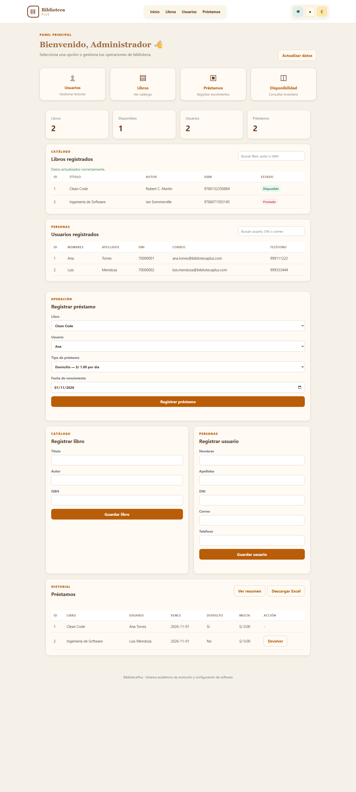
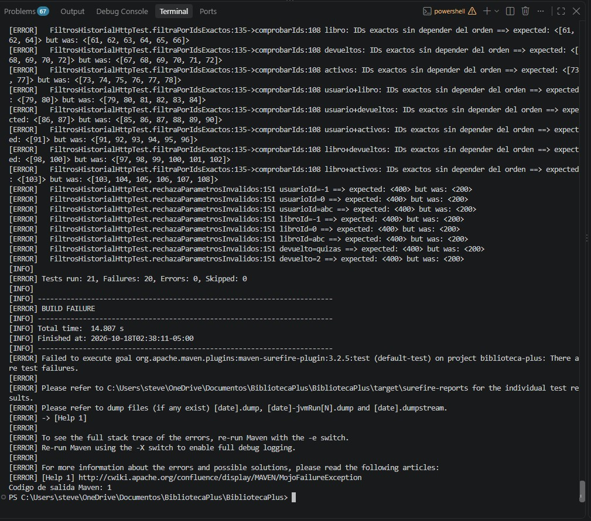

# RFC-014 · Búsqueda y filtrado del historial de préstamos

| Campo | Valor |
|---|---|
| Issue | [#14](https://github.com/nn-nnhub/BibliotecaPlus/issues/14) |
| Responsable | Stevens |
| Tipo / prioridad / riesgo | Perfectivo / Media / Bajo-Medio |
| Rama | `rfc-014-filtros-historial` |
| Base | `7b51b3648652777139b2debf8ff41ea31d7c4e95` (`origin/main`) |
| Estado | Pruebas y capturas ANTES verificadas; solución no implementada |

El usuario autorizó únicamente esta fase de pruebas y evidencias ANTES. El texto del Issue consultado todavía figura como propuesta pendiente de aprobación. No se modificó el Issue.

La base incorpora RFC-012. La rama no hereda los cuatro commits exclusivos del RFC-013 ni su configuración de bloqueo/Surefire; el PR #21 no se modificó. Fotografía del trabajo previo a esta fase: **8 de 30 commits propios** entre los tres RFC. No hay commits RFC-014 todavía.

## Diagnóstico del código actual

`PrestamoController.listarTodos()` no declara parámetros. Invoca `PrestamoService.listarTodos()` y este llama a `PrestamoRepository.findAll()`. Los parámetros enviados no participan en la consulta. `app.js` carga el historial completo en `estado.prestamos` y `mostrarPrestamos()` dibuja todas sus filas. `index.html` no contiene controles de usuario, libro o devolución para el historial.

La tabla sí permite devolver préstamos y ofrece resumen y CSV, que deben mantener su comportamiento. La tarjeta global `totalPrestamos` se actualiza con la longitud del historial: el futuro filtrado no debe convertir ese total global en un conteo de coincidencias.

## Contrato propuesto para DESPUÉS

- `GET /api/prestamos` sin parámetros: misma respuesta JSON y alcance completo.
- `usuarioId` y `libroId`: IDs positivos representables como Long; coincidencia exacta. IDs válidos sin registros coincidentes producen `[]`, no 404.
- `devuelto=true`: devueltos; `devuelto=false`: activos; ausente: ambos. La interfaz omitirá parámetros sin seleccionar. El contrato de esta matriz admite los literales `true` y `false`; los valores probados `quizas` y `2` deben rechazarse.
- Los criterios se combinan con AND. Ejemplo: `?usuarioId=1&libroId=2&devuelto=false`.
- IDs negativos, cero, valores no numéricos y estado inválido: HTTP 400 controlado. Todavía no se afirma que el código actual implemente estas validaciones.
- La interfaz permitirá aplicar y limpiar filtros, recuperando el historial completo sin alterar reportes ni CSV.

## Metodología de pruebas ANTES

Se creó [FiltrosHistorialHttpTest](../src/test/java/com/bibliotecaplus/integration/FiltrosHistorialHttpTest.java). Es integración HTTP con MockMvc, servicio y repositorios reales. No se simulan respuestas y no se ejecuta contra la base local.

Configuración explícita: `jdbc:h2:mem:rfc014-antes;DB_CLOSE_DELAY=-1`, esquema `create-drop`, consola H2 y open-in-view desactivados. Antes de limpiar datos en cada caso se comprueba por metadatos la URL exacta `jdbc:h2:mem:rfc014-antes` y autocommit. Las nueve clases de integración preexistentes también declaran URLs H2 en memoria. No se abrió `./data/bibliotecadb`.

Cada caso reconstruye dos usuarios, dos libros y seis préstamos en esa base aislada. Se usan IDs generados, no IDs fijos. Las fechas de los datos son fijas. La preparación por repositorios representa historial persistido y no pretende probar las reglas de alta de préstamos.

| Registro lógico | Usuario | Libro | Estado |
|---|---|---|---|
| P1 | U1 | L1 | Activo |
| P2 | U1 | L1 | Devuelto |
| P3 | U1 | L2 | Devuelto |
| P4 | U2 | L1 | Devuelto |
| P5 | U2 | L2 | Activo |
| P6 | U2 | L2 | Devuelto |

Los símbolos U1/L1 del registro se sustituyen por los IDs reales al construir las peticiones. Las aserciones ordenan las listas de IDs esperados y observados y las comparan completas: no dependen del orden HTTP ni permiten IDs adicionales o duplicados. Los IDs numéricos aumentan entre casos porque no se reinician las secuencias; las relaciones y los subconjuntos esperados son deterministas.

Las 21 ejecuciones se distribuyen en: 1 control sin filtros, 12 casos válidos y 8 inválidos. Se cubren filtros individuales, las tres parejas, los tres criterios juntos, true/false y ausencia de coincidencias.

## Ejecuciones y resultados reales

Se seleccionó explícitamente Temurin **17.0.20.1** mediante JAVA_HOME. Maven **3.10.0** confirmó ese JDK. Ambas ejecuciones comenzaron con `clean` para descartar compilados e informes de otras ramas. No se modificó producción entre ejecuciones ni se ajustaron las aserciones para fabricar resultados.

Primero, control independiente:

```powershell
mvn -B clean "-Dtest=FiltrosHistorialHttpTest#controlSinFiltrosDevuelveHistorialCompleto" test
```

Resultado: **1 prueba, 0 fallos, 0 errores, 0 omitidas; BUILD SUCCESS; salida 0**. HTTP 200 y los seis IDs exactos. Marca de finalización del proceso: `2026-10-18T02:33:18-05:00`.

Después, clase completa:

```powershell
mvn -B clean "-Dtest=FiltrosHistorialHttpTest" test
```

Resultado: **21 pruebas, 20 fallos, 0 errores, 0 omitidas; BUILD FAILURE; salida 1**. El informe XML coincide con el resumen de Maven. Marca de finalización: `2026-10-18T02:34:02-05:00`.

| Grupo | Casos | Observación ANTES | Resultado |
|---|---|---|---|
| Sin filtros | 1 | HTTP 200 y los seis IDs correctos | Pasa |
| Filtros válidos, individuales y combinados | 11 | HTTP 200 con los seis préstamos en vez del subconjunto exacto | Fallan |
| Sin coincidencias | 1 | HTTP 200 con seis préstamos en vez de `[]` | Falla |
| IDs negativos/cero/no numéricos para ambos IDs y dos estados inválidos | 8 | HTTP 200 en lugar de 400 | Fallan |

La causa comprobada es que el endpoint actual ignora esos parámetros y consulta todo el historial. Los errores son aserciones de contrato incumplidas, no fallos de contexto, Java, conexión ni compilación. [Salida literal de ambas ejecuciones](evidencias/rfc-014-antes-despues.txt). No se ejecutó la suite completa del proyecto en esta fase.

## Captura auténtica de interfaz ANTES



Se obtuvo con Chrome en modo headless sobre la aplicación real sin modificar, escuchando exclusivamente en `127.0.0.1:18014`. El arranque sustituyó expresamente la base por `jdbc:h2:mem:rfc014-captura`, con `ddl-auto=create-drop` y consola H2 desactivada. Se usó un perfil temporal de navegador en `target/chrome-rfc014`.

Los dos registros visibles se crearon por la API real: préstamo de libro 1/usuario 1 seguido de devolución, y préstamo activo de libro 2/usuario 2. Esta base es distinta de la matriz HTTP y no contiene datos reales. El registro de evidencia conserva el estado recibido por la API. La imagen muestra la tabla del historial y la ausencia de controles de filtros; no es un montaje. La captura inicial recortaba la tabla y fue sustituida por una captura real con altura 3200, inspeccionada visualmente.

## Captura auténtica de terminal ANTES



Se verificaron la firma JPEG `FF-D8-FF`, la decodificación como JPEG y el contenido visual de la imagen de 1009 × 891 píxeles. Muestra la terminal de VS Code con las aserciones de IDs y parámetros inválidos, el resumen **Tests run: 21, Failures: 20, Errors: 0, Skipped: 0**, **BUILD FAILURE** y **Código de salida Maven: 1**.

La captura corresponde a la repetición real ejecutada por el usuario, cuya marca visible de finalización es `2026-10-18T02:38:11-05:00`. Coincide en resultados y ejemplos de IDs con la matriz registrada anteriormente; no se presenta como imagen de la ejecución original de las 02:34:02. El registro original se conserva íntegro, sin sustituir sus marcas ni sus resultados por los de esta repetición. No se modificaron las aserciones ni se editó la captura.

## Plan posterior, todavía sin implementar

1. Tras aprobación, añadir parámetros opcionales y validación al controlador, con una consulta parametrizada del repositorio que combine criterios por AND. Conservar el listado completo sin filtros.
2. Añadir controles propios al historial y acciones Aplicar/Limpiar, conservando la selección al actualizar o devolver. Mantener el total global independiente de los resultados visibles.
3. Repetir exactamente las aserciones HTTP y añadir cobertura JavaScript de construcción de parámetros, aplicación, limpieza, actualización y presentación vacía.
4. Verificar RFC-012 (atomicidad), RFC-003 (reportes/CSV) y RFC-011 (escape HTML/CSV y consultas por lotes). Mantener resumen y exportación completos, BOM, cabeceras, columnas y límites de consultas existentes.
5. Ejecutar dirigida, suite completa Maven y pruebas JavaScript con Java 17 y H2 en memoria para integraciones. Registrar resultados reales DESPUÉS y capturas de terminal e interfaz filtrada/limpia.

No se eligió una cantidad artificial de commits. Propuesta inicial para esta fase: `test(rfc-014): evidenciar ausencia de filtros del historial` con `Refs #14`, incluyendo prueba, documento, registro y capturas verificadas. Esperar autorización explícita antes de crear el commit o implementar filtros.
