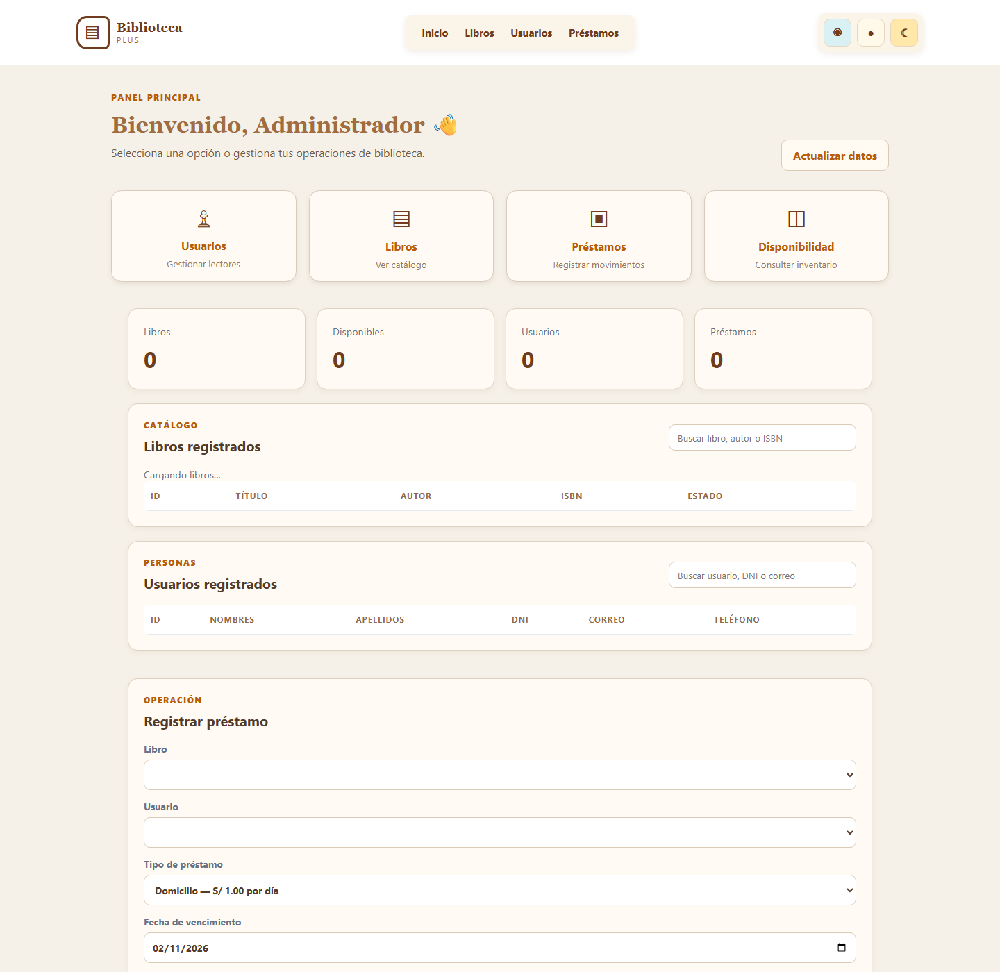
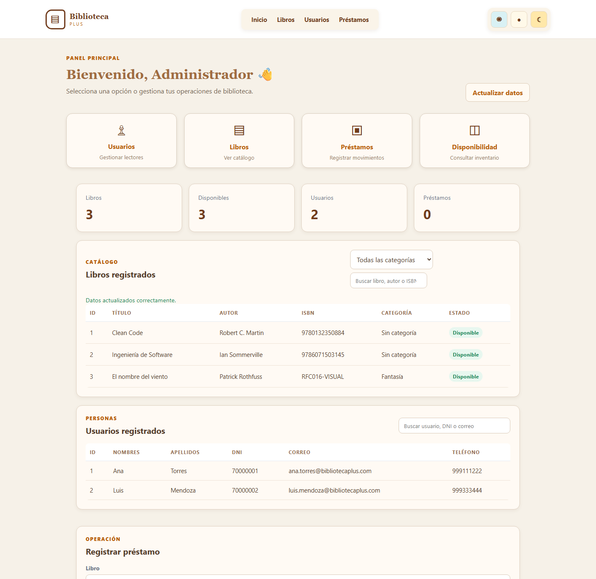

# RFC-016 · Categorías de libros

| Campo | Valor |
|---|---|
| Issue | #16 |
| Rama | `rfc-016-categorias` |
| Base | `origin/main` |
| Estado | Funcionalidad implementada y pruebas DESPUÉS aprobadas; pendiente de revisión |

## Objetivo

Permitir que cada libro tenga una categoría opcional y que el catálogo pueda filtrarse por ella, sin introducir una tabla adicional ni alterar préstamos o datos existentes.

## Alcance acordado

- Añadir `String categoria` a `Libro`.
- Aceptar la categoría al registrar libros.
- Consultar `GET /api/libros?categoria=...` sin distinguir mayúsculas y minúsculas.
- Mostrar `Sin categoría` para libros antiguos, categorías omitidas o vacías.
- Recortar espacios al principio y al final de las categorías informadas.
- Limitar la categoría a 100 caracteres.
- Añadir categoría y un filtro al catálogo web.
- Mantener compatible el JSON anterior, que no contiene `categoria`.
- Conservar sin cambios la disponibilidad y el flujo de préstamos.

Quedan fuera de este RFC una entidad o tabla de categorías, la edición de libros del RFC-015 y cualquier modificación de la lógica de préstamos.

## Contrato de pruebas ANTES

Se creó `CategoriasLibrosHttpTest`, con siete casos HTTP reales sobre MockMvc. La clase fuerza `jdbc:h2:mem:rfc016-antes`, usa `ddl-auto=create-drop`, desactiva la consola H2 y comprueba por metadatos la URL antes de limpiar datos. No usa `./data/bibliotecadb`.

Los casos cubren registro, consulta por categoría, representación de registros antiguos, normalización, longitud máxima, compatibilidad con clientes anteriores y conservación del préstamo/disponibilidad.

También se creó `categorias-libros.test.js`, con dos casos de interfaz: filtrado del catálogo y representación `Sin categoría`. Utiliza el DOM simulado y el cargador ya empleados por las pruebas JavaScript existentes.

## Resultado inicial

La ejecución Java del 18 de octubre de 2026 produjo **7 pruebas: 2 aprobadas, 5 fallidas, 0 errores y 0 omitidas**. Pasan la compatibilidad del alta sin categoría y el comportamiento actual de préstamo/disponibilidad. Fallan los cinco contratos que dependen de la funcionalidad todavía inexistente:

- la respuesta no incluye `categoria` al registrar;
- el parámetro `categoria` es ignorado al listar;
- los registros antiguos no exponen `Sin categoría`;
- no se normalizan espacios;
- una categoría de 101 caracteres se acepta con HTTP 201 en vez de rechazarse con HTTP 400.

Las pruebas JavaScript no pudieron ejecutarse porque Node.js no está instalado o disponible en `PATH`. Permanecen preparadas para la fase DESPUÉS; no se les atribuye un resultado no observado.

La salida resumida y las condiciones de ejecución están en [rfc-016-antes-despues.txt](evidencias/rfc-016-antes-despues.txt).

## Evidencia visual ANTES

La captura se obtuvo de Chrome headless contra una instancia real del código actual en `127.0.0.1:18016`, arrancada exclusivamente con `jdbc:h2:mem:rfc016-captura` y `ddl-auto=create-drop`. La tabla muestra las columnas ID, Título, Autor, ISBN y Estado, y una búsqueda limitada a libro, autor o ISBN: no existe columna ni filtro de categoría. La instancia temporal fue detenida después de capturar.

## Implementación DESPUÉS

`Libro` incorpora una columna nullable `categoria` de hasta 100 caracteres sin cambiar sus constructores. El valor almacenado sigue siendo `null` para libros antiguos o sin clasificar, mientras que la respuesta JSON muestra `Sin categoría`. De esta forma no es necesaria una migración destructiva ni una tabla adicional.

`LibroService` recorta los extremos, convierte texto vacío en ausencia de categoría y rechaza más de 100 caracteres. `PUT` solo cambia la categoría cuando el cliente envía el campo, por lo que clientes anteriores no borran el valor existente; la disponibilidad nunca se copia desde la solicitud.

`GET /api/libros?categoria=...` realiza una consulta sin distinguir mayúsculas y minúsculas. `Sin categoría` incluye valores nulos o vacíos. Sin parámetro se conserva `findAll()`.

La web incorpora selector de categoría en el alta, columna Categoría y filtro dinámico `Todas las categorías`. La búsqueda por título, autor o ISBN se combina con el filtro. El selector de libros disponibles para préstamos mantiene su lógica anterior. No se añadió edición web ni se modificó `PrestamoService`.

## Resultados DESPUÉS

| Ejecución | Resultado |
|---|---|
| `mvn -B "-Dtest=CategoriasLibrosHttpTest" test` | 10 pruebas, 0 fallos, 0 errores, 0 omitidas; BUILD SUCCESS |
| `mvn -B test` | 129 pruebas en 22 clases, 0 fallos, 0 errores, 0 omitidas; BUILD SUCCESS |
| `node --test "src/test/js/*.test.js"` | No ejecutado: Node.js no está disponible en `PATH` |

Todas las clases Spring de la suite declaran una URL `jdbc:h2:mem:`. La clase RFC-016 además usa `create-drop` y verifica su URL exacta antes de limpiar datos. No se accedió a `./data/bibliotecadb`.

La cobertura RFC-016 final incluye los siete contratos iniciales y tres casos adicionales: categoría vacía filtrable como `Sin categoría`, actualización de categoría sin cambiar disponibilidad y actualización de un cliente anterior sin borrar la categoría.

## Evidencia visual DESPUÉS

La captura real muestra los dos libros iniciales como `Sin categoría`, un libro creado mediante la API con categoría `Fantasía`, la nueva columna y el selector `Todas las categorías`. Se obtuvo con Chrome headless contra `jdbc:h2:mem:rfc016-despues`, `create-drop` y el puerto aislado 18016. La instancia fue detenida después.

No se realizaron commit, push ni merge.
