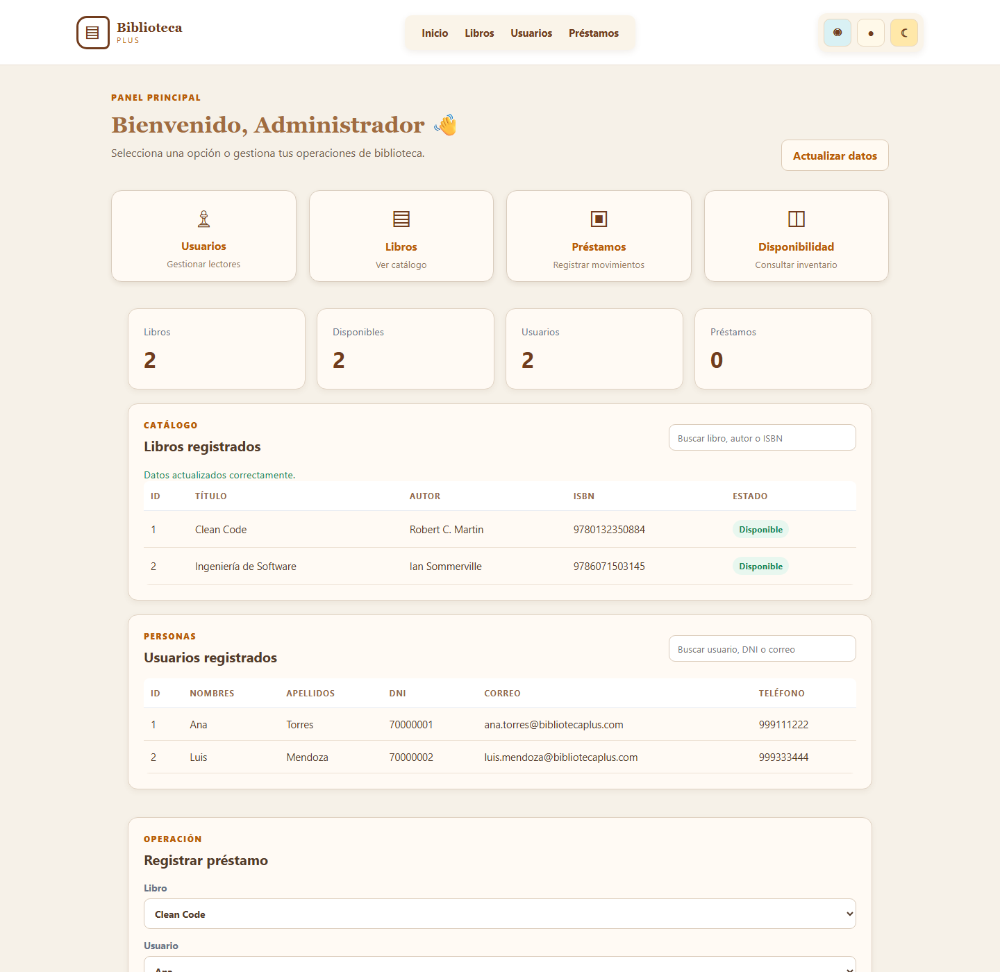
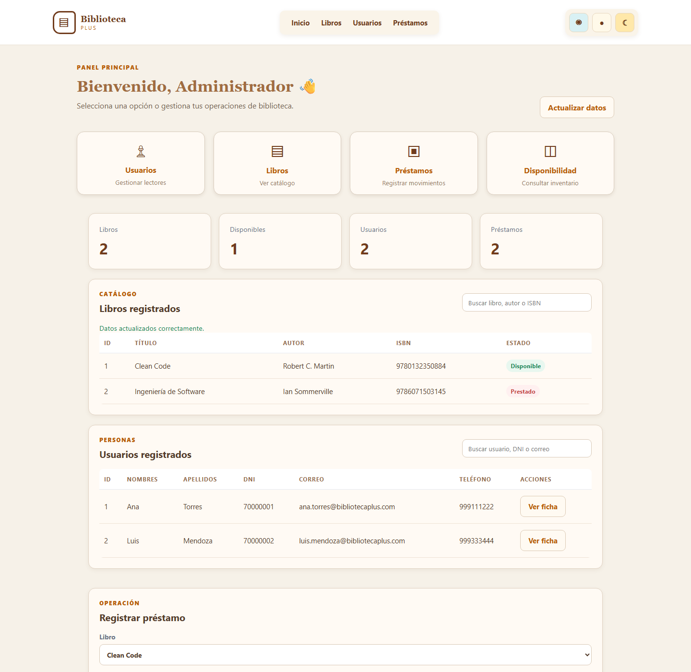
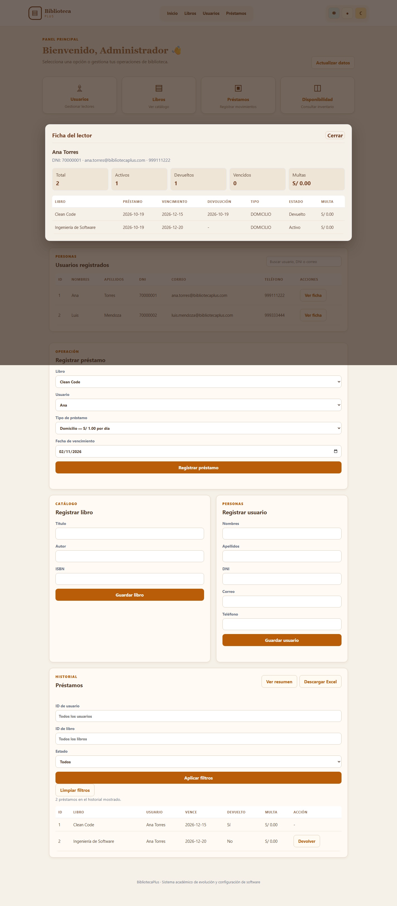

# RFC-017 · Ficha consolidada e historial de cada lector

| Campo | Valor |
|---|---|
| Issue | [#30](https://github.com/nn-nnhub/BibliotecaPlus/issues/30) |
| Rama | `rfc-017-ficha-lector` |
| Base | `origin/main` |
| Estado | Funcionalidad implementada, pruebas Java DESPUÉS aprobadas y evidencia visual completada; pendiente de revisión |

## Objetivo

Ofrecer una ficha de cada lector con sus datos personales, un resumen de actividad y el historial de préstamos, sin modificar el estado de usuarios, libros o préstamos.

## Diagnóstico del código actual

`Usuario` contiene `id`, `nombre`, `apellidos`, `dni`, `correo` y `telefono`. `Prestamo` no tiene una relación JPA con el lector o el libro: almacena `usuarioId` y `libroId`, además de `fechaPrestamo`, `fechaVencimiento`, `fechaDevolucion`, `tipoPrestamo`, `devuelto` y `multa`.

La multa se calcula y persiste al devolver un préstamo. Un préstamo activo que ya venció conserva normalmente multa cero hasta su devolución. El repositorio de préstamos ya permite filtrar por `usuarioId`, pero no existe un servicio de ficha consolidada ni el endpoint `GET /api/usuarios/{id}/ficha`.

La interfaz lista usuarios en una tabla, sin columna de acciones, botón `Ver ficha`, panel o diálogo de detalle.

## Contrato propuesto

La respuesta del futuro endpoint tendrá tres secciones:

```json
{
  "usuario": {},
  "resumen": {
    "totalPrestamos": 0,
    "prestamosActivos": 0,
    "prestamosDevueltos": 0,
    "prestamosVencidos": 0,
    "multasAcumuladas": 0.0
  },
  "historial": []
}
```

Cada elemento de `historial` incluirá `id`, `libroId`, `libroTitulo`, las tres fechas reales, `tipoPrestamo`, `devuelto`, `vencido` y `multa`. El historial se ordenará por `fechaPrestamo` descendente.

Las decisiones de contrato que deben revisarse antes de implementar son:

- `prestamosVencidos` cuenta únicamente préstamos no devueltos cuya `fechaVencimiento` es anterior a la fecha actual.
- `multasAcumuladas` suma los importes persistidos; no proyecta una multa hipotética para préstamos activos vencidos.
- Un usuario existente sin préstamos obtiene HTTP 200, contadores en cero e historial vacío.
- Un usuario inexistente obtiene HTTP 404 con el mensaje ya usado por `UsuarioService`.
- La consulta es de solo lectura y no actualiza multas, disponibilidad, fechas ni estados.

## Pruebas ANTES

Se creó `FichaLectorHttpTest` con ocho casos. Usa MockMvc y repositorios reales sobre `jdbc:h2:mem:rfc017-antes`, `create-drop`, consola desactivada y verificación de la URL JDBC antes de limpiar fixtures.

Los casos cubren el endpoint actual como control, usuario inexistente, lector sin préstamos, resumen de activos/devueltos/vencidos, contenido del historial, multa acumulada y ausencia de mutaciones.

Se creó también `ficha-lector.test.js` con seis contratos de interfaz: botón `Ver ficha`, apertura, cierre, resumen e historial, estado vacío y escape XSS. Las pruebas usan el mismo DOM simulado de la suite existente.

## Resultados reales ANTES

La prueba Java dirigida produjo **8 pruebas: 1 aprobada, 7 fallidas, 0 errores y 0 omitidas**. El control `GET /api/usuarios/{id}` pasa. Los siete contratos de ficha fallan porque la ruta nueva todavía no existe: los casos de usuarios existentes reciben HTTP 404 en lugar de 200, y el caso inexistente recibe el 404 genérico sin el mensaje JSON esperado.

La prueba de solo lectura ejecutó todas sus aserciones con `assertAll`: usuarios, libros, préstamos, disponibilidad y multa permanecieron iguales. Su único fallo fue el estado HTTP 404 en vez de 200.

Las seis pruebas JavaScript no pudieron ejecutarse porque Node.js no está instalado o disponible en `PATH`. No se les atribuye un resultado.

La salida y las condiciones de ejecución están registradas en [rfc-017-antes-despues.txt](evidencias/rfc-017-antes-despues.txt).

## Captura auténtica ANTES



La captura fue obtenida con Chrome headless contra la aplicación real sin modificar, en `127.0.0.1:18017`, usando exclusivamente `jdbc:h2:mem:rfc017-captura` y `create-drop`. Muestra la tabla de usuarios con ID, nombres, apellidos, DNI, correo y teléfono, sin columna de acciones ni botón `Ver ficha`. La instancia temporal fue detenida después de capturar.

## Implementación DESPUÉS

Se creó `FichaLector` como DTO inmutable y `FichaLectorService` como servicio de solo lectura. La consolidación valida primero el usuario, consulta sus préstamos ordenados y resuelve todos los libros mediante un único `findAllById`. No realiza una consulta por cada fila ni guarda entidades.

El resumen se calcula sobre los valores persistidos. `vencido` se deriva sin modificar el préstamo y `multasAcumuladas` suma `Prestamo.multa`. No se cambiaron `PrestamoService`, `CalculadorMulta`, registro o devolución.

`UsuarioController` expone `GET /api/usuarios/{id}/ficha`. La interfaz incorpora una columna Acciones, botones `Ver ficha` y un diálogo con identidad, resumen e historial. Todo valor de usuario o libro se procesa mediante `escaparHtml`; el estado vacío se presenta expresamente.

## Resultados DESPUÉS

| Ejecución | Resultado real |
|---|---|
| `mvn -B "-Dtest=FichaLectorHttpTest" test` | 8 pruebas, 0 fallos, 0 errores, 0 omitidas; BUILD SUCCESS |
| `mvn -B test` | 137 pruebas en 23 clases, 0 fallos, 0 errores, 0 omitidas; BUILD SUCCESS |
| `node --test "src/test/js/ficha-lector.test.js"` | No ejecutado: Node.js no está disponible en `PATH` |

Todas las pruebas Spring usan URLs H2 en memoria. La clase RFC-017 conservó `create-drop` y la verificación de URL. No se accedió a `./data/bibliotecadb`.

## Captura auténtica DESPUÉS



La captura muestra la nueva columna Acciones y los botones `Ver ficha` sobre una instancia real con dos préstamos de demostración. Se obtuvo en `127.0.0.1:18017` con `jdbc:h2:mem:rfc017-despues` y `create-drop`. La API real de ficha devolvió un préstamo activo, uno devuelto, sus títulos y el resumen 2/1/1. La imagen no se presenta como evidencia del diálogo abierto; ese comportamiento queda cubierto por los contratos JavaScript pendientes de Node.js. La instancia fue detenida.



La evidencia adicional se obtuvo mediante un clic real en `Ver ficha` dentro de Chrome headless contra una nueva instancia temporal, configurada con `jdbc:h2:mem:rfc017-ficha-abierta` y `create-drop`. Antes de guardar la imagen se verificó que el diálogo estaba abierto y mostraba a Ana Torres, el resumen de dos préstamos —uno activo y uno devuelto— y el historial de `Clean Code` e `Ingeniería de Software`. La captura fue inspeccionada visualmente y los procesos temporales se detuvieron después.

No se realizaron commit, push ni merge.
