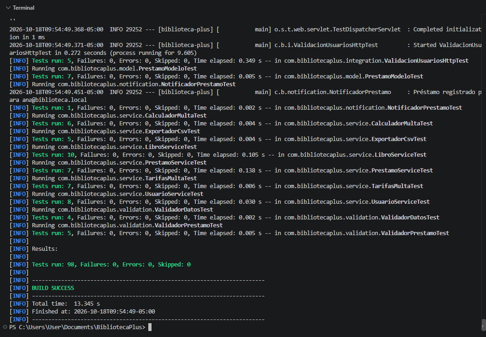
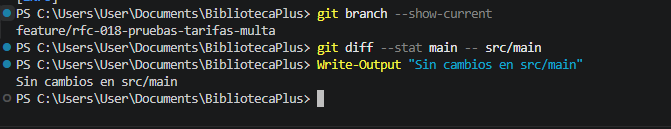

# RFC-018 · Pruebas automatizadas de las tarifas de multa

| Campo | Valor |
|---|---|
| Issue | [#16](https://github.com/nn-nnhub/BibliotecaPlus/issues/16) |
| Tipo de mantenimiento | Preventivo |
| Riesgo | Bajo |
| Prioridad | Media |
| Costo estimado | Bajo |
| Responsable | Keivan Yadir Valencia Lezameta |
| Fecha propuesta | 17/10/2026 |
| Etiquetas | RFC · Media · Mejora |

## Relación con el RFC

Este RFC trata un único cambio: agregar pruebas unitarias directas para las tres tarifas de multa. No modifica código de producción, interfaz ni la persistencia H2 (RFC-008). `CalculadorMultaTest` (RFC-009) no se modifica.

## Descripción del cambio

Se agrega la clase `TarifasMultaTest` en `src/test/java/com/bibliotecaplus/service/` con 7 pruebas:

| Prueba | Verifica |
|---|---|
| `tarifaDomicilioCobraUnSolPorDia` | `valorDiario` de `TarifaDomicilio` = 1.0. |
| `tarifaEspecialCobraDosSolesPorDia` | `valorDiario` de `TarifaEspecial` = 2.0. |
| `tarifaGeneralCobraMedioSolPorDia` | `valorDiario` de `TarifaGeneral` = 0.5. |
| `tarifaDomicilioSoloAplicaAlTipoDomicilioSinImportarMayusculas` | `aplicaA` solo para `DOMICILIO`, sin distinguir mayúsculas; `null` no aplica. |
| `tarifaEspecialSoloAplicaAlTipoEspecialSinImportarMayusculas` | `aplicaA` solo para `ESPECIAL`, sin distinguir mayúsculas; `null` no aplica. |
| `tarifaGeneralAplicaACualquierTipo` | `aplicaA` devuelve `true` para cualquier tipo, incluido `null`. |
| `soloLaTarifaGeneralEsPorDefecto` | Solo `TarifaGeneral` devuelve `esPorDefecto() = true`. |

## Justificación

Las tarifas solo se probaban de forma indirecta a través de `CalculadorMulta` (RFC-009). Si alguien cambia por accidente el valor diario o la regla `aplicaA` de una tarifa, el fallo aparece lejos de su causa. Las pruebas directas protegen el cálculo de multas ante cambios futuros.

## Impacto en el sistema

- Se agrega un solo archivo en `src/test`.
- No se modifica ningún archivo de `src/main` (ver evidencia).
- No se toca `application.properties` ni la configuración de H2.

## Criterios de aceptación

1. `TarifaDomicilio` cobra S/ 1.00 por día, `TarifaEspecial` S/ 2.00 y `TarifaGeneral` S/ 0.50.
2. Solo `TarifaGeneral` devuelve `esPorDefecto() = true`.
3. `TarifaGeneral` aplica a cualquier tipo; las otras solo a su tipo.
4. `mvn clean test` termina en `BUILD SUCCESS`.
5. `git diff --stat main -- src/main` no muestra cambios.

## Evidencias visuales

### Pruebas automatizadas



### Código de producción sin cambios



## Resultado

- 7 pruebas nuevas, todas exitosas.
- Suite completa: 98 pruebas, 0 fallos, 0 errores.
- Código de producción sin cambios.

## Validación automatizada

Comandos ejecutados (PowerShell, desde la raíz del proyecto):

```powershell
mvn test "-Dtest=TarifasMultaTest"
mvn clean test
git diff --stat main -- src/main
```

Resultado: `TarifasMultaTest` con `Tests run: 7, Failures: 0, Errors: 0`; suite completa con `Tests run: 98, Failures: 0, Errors: 0, Skipped: 0` y `BUILD SUCCESS`.

## Riesgos y limitaciones

- Las pruebas fijan los valores actuales de las tarifas. Si un RFC futuro los cambia a propósito, habrá que actualizar los valores esperados.
- No prueba la selección entre tarifas; eso lo cubre `CalculadorMultaTest` (RFC-009).
- El total de 98 pruebas corresponde a la rama del RFC-018 al momento de la captura; puede variar cuando se integren otros RFC.