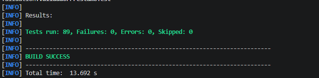
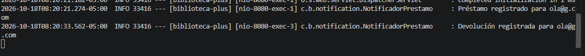
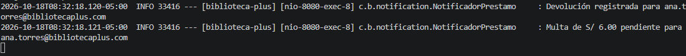

# RFC-019 · Notificación de devolución y de multa

| Campo | Valor |
|---|---|
| Issue | [#17](https://github.com/nn-nnhub/BibliotecaPlus/issues/17) |
| Tipo de mantenimiento | Perfectivo |
| Riesgo | Bajo |
| Prioridad | Media |
| Costo estimado | Bajo |
| Responsable | ‹Keivan Yadir Valencia Lezameta› |
| Fecha propuesta | 18/10/2026 |
| Etiquetas | RFC · Media · Mejora |

## Relación con el RFC

Este RFC amplía el registro de eventos del préstamo. Si se encuentra al usuario, el sistema escribe en el log la devolución y, cuando corresponde, el importe de la multa.

No modifica reglas de multas (RFC-009), transaccionalidad (RFC-012), concurrencia (RFC-013) ni la configuración de H2 (RFC-008).

## Descripción del cambio

- `Notificador` incorpora dos métodos: `notificarDevolucion(Usuario)` y `notificarMulta(Usuario, double)`.
- `NotificadorPrestamo` los implementa con `LOGGER.info`:
  - `Devolución registrada para {correo}`
  - `Multa de S/ X.XX pendiente para {correo}` (monto con dos decimales y punto decimal, independiente del idioma del sistema).
- `PrestamoService.devolver(Long)` guarda el préstamo y luego llama a un método privado que busca al usuario con `usuarioRepository.findById(...)`:
  - notifica la devolución siempre;
  - notifica la multa solo si `multa > 0`;
  - si el usuario ya no existe, la devolución se completa sin error y no se notifica.

## Justificación

El log permite comprobar qué ocurrió al devolver un préstamo. La interfaz existente (`Notificador`) permite incorporar en el futuro un canal de entrega al usuario.

## Impacto en el sistema

| Archivo | Cambio |
|---|---|
| `notification/Notificador.java` | Dos métodos nuevos en la interfaz |
| `notification/NotificadorPrestamo.java` | Implementación con log |
| `service/PrestamoService.java` | `devolver` llama a `notificarDevolucion(prestamo)` |

- No se agregan campos a `Prestamo` ni se cambia el esquema: **no se toca la configuración de H2 ni `application.properties`**.
- La API no cambia: `PUT /api/prestamos/{id}/devolver` responde igual.
- Ninguna otra clase implementa `Notificador`, por lo que agregar métodos a la interfaz no rompe otras implementaciones.

## Criterios de aceptación

1. Al devolver un préstamo a tiempo se registra `Devolución registrada para {correo}` y **no** se registra ninguna multa.
2. Al devolver con retraso se registran `Devolución registrada para {correo}` y `Multa de S/ X.XX pendiente para {correo}`.
3. Si el usuario del préstamo ya no existe, la devolución se completa y no se lanza excepción.
4. El monto de la multa siempre se muestra con dos decimales y punto.
5. Las pruebas existentes siguen pasando.

## Evidencias visuales

### Pruebas Java del PR



### Devolución a tiempo (sin multa)

En la terminal se ven el registro del préstamo y su devolución, sin entrada de multa.



### Devolución con retraso (con multa)

La terminal muestra la devolución seguida de una multa pendiente de S/ 6.00.



## Resultado

- Si se encuentra al usuario, la devolución queda registrada en el log.
- El log incluye una segunda entrada si la multa es mayor que cero.
- Una devolución con usuario inexistente no falla.

## Validación automatizada

- `NotificadorPrestamoTest` (3): verifica con un `ListAppender` de Logback los mensajes de registro, devolución y multa, incluido el formato del monto.
- `PrestamoDevolucionNotificacionTest` (3, Mockito):
  - devolución a tiempo: notifica la devolución y nunca la multa;
  - devolución con retraso: notifica devolución y multa de 3.0;
  - usuario inexistente: no notifica nada y no lanza excepción.

Comandos ejecutados (PowerShell, desde la raíz del proyecto):

```powershell
mvn clean test
mvn test "-Dtest=NotificadorPrestamoTest,PrestamoDevolucionNotificacionTest"
```

| Momento de validación | Java | JavaScript | Evidencia |
|---|---:|---:|---|
| Ejecución histórica | 86 | — | Resultado consignado en la versión anterior de esta RFC |
| Revisión del PR | 89 | 10 | Java según la captura de Maven. JavaScript según la revisión del [PR #25](https://github.com/nn-nnhub/BibliotecaPlus/pull/25) |
| Integración con main | 124 | 19 | Cifras posteriores a la integración, según la revisión |

## Pasos para reproducir la prueba manual

1. Arrancar la aplicación sin el SQL de Hibernate en pantalla (no modifica `application.properties`):
```powershell
   chcp 65001
   mvn spring-boot:run "-Dspring-boot.run.arguments=--spring.jpa.show-sql=false"
```
2. **Sin multa:** en `http://localhost:8080` registrar un préstamo con vencimiento futuro y pulsar **Devolver**. En la terminal aparece solo `Devolución registrada para ...`.
3. **Con multa:** registrar otro préstamo y no devolverlo. En `http://localhost:8080/h2-console` (URL `jdbc:h2:file:./data/bibliotecadb`, usuario `sa`) ejecutar:
```sql
   SELECT ID, FECHA_VENCIMIENTO, DEVUELTO FROM PRESTAMO;
   UPDATE PRESTAMO SET FECHA_VENCIMIENTO = DATEADD('DAY', -3, CURRENT_DATE) WHERE ID = ‹ID›;
```
   Recargar la página y pulsar **Devolver**. Comprobar en la terminal las entradas de devolución y multa.

El `UPDATE` es necesario porque el RFC-009 impide registrar vencimientos pasados. Solo afecta la base local de prueba; el archivo `data/` no se versiona ni se incluye en el Pull Request.

## Riesgos y limitaciones

- **Canal de notificación:** por ahora es solo un log; no se envía correo real. La interfaz `Notificador` deja preparada esa ampliación.
- **Datos personales en el log:** se registra el correo del usuario, igual que ya hacía `notificarRegistro`.
- **Usuario eliminado:** si el usuario del préstamo ya no existe, la devolución se completa pero no se notifica.
- **Fuera de alcance:** el cálculo de multas (RFC-009), la atomicidad (RFC-012) y la concurrencia (RFC-013).
