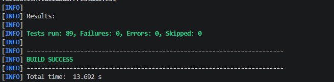
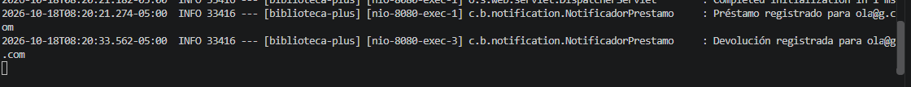
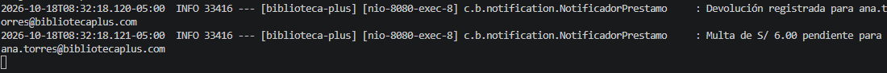

# RFC-019 · Notificación de devolución y de multa

| Campo | Valor |
|---|---|
| Issue | [#‹NÚMERO›](https://github.com/nn-nnhub/BibliotecaPlus/issues/‹NÚMERO›) |
| Tipo de mantenimiento | Perfectivo |
| Riesgo | Bajo |
| Prioridad | Media |
| Costo estimado | Bajo |
| Responsable | ‹Keivan Yadir Valencia Lezameta› |
| Fecha propuesta | 18/10/2026 |
| Etiquetas | RFC · Media · Mejora |

## Relación con el RFC

Este RFC trata un único cambio: avisar al usuario cuando se registra la devolución de un préstamo y, si corresponde, cuando la devolución genera una multa. Hoy el sistema solo notifica el registro del préstamo (`notificarRegistro`); la devolución y la multa se calculan pero no se comunican.

No modifica reglas de multas (RFC-009), transaccionalidad (RFC-012), concurrencia (RFC-013) ni la configuración de H2 (RFC-008).

## Descripción del cambio

- `Notificador` incorpora dos métodos: `notificarDevolucion(Usuario)` y `notificarMulta(Usuario, double)`.
- `NotificadorPrestamo` los implementa con `LOGGER.info`:
  - `Devolución registrada para {correo}`
  - `Multa de S/ X.XX pendiente para {correo}` (monto con dos decimales y punto decimal, independiente del idioma del sistema).
- `PrestamoService.devolver(Long)` guarda el préstamo y luego llama a un método privado que busca al usuario con `usuarioRepository.findById(...)`:
  - notifica la devolución siempre;
  - notifica la multa solo si `multa > 0`;
  - si el usuario ya no existe, la devolución se completa sin error y no se notifica.

## Justificación

La notificación de registro ya existía, pero el usuario no recibía confirmación de la devolución ni aviso de la multa. El cambio completa el ciclo de notificaciones usando la abstracción existente (`Notificador`), por lo que en el futuro se puede sustituir el log por correo sin tocar `PrestamoService`.

## Impacto en el sistema

| Archivo | Cambio |
|---|---|
| `notification/Notificador.java` | Dos métodos nuevos en la interfaz |
| `notification/NotificadorPrestamo.java` | Implementación con log |
| `service/PrestamoService.java` | `devolver` llama a `notificarDevolucion(prestamo)` |

- No se agregan campos a `Prestamo` ni se cambia el esquema: **no se toca la configuración de H2 ni `application.properties`**.
- La API no cambia: `PUT /api/prestamos/{id}/devolver` responde igual.
- Ninguna otra clase implementa `Notificador`, por lo que agregar métodos a la interfaz no rompe otras implementaciones.

## Criterios de aceptación

1. Al devolver un préstamo a tiempo se registra `Devolución registrada para {correo}` y **no** se registra ninguna multa.
2. Al devolver con retraso se registran `Devolución registrada para {correo}` y `Multa de S/ X.XX pendiente para {correo}`.
3. Si el usuario del préstamo ya no existe, la devolución se completa y no se lanza excepción.
4. El monto de la multa siempre se muestra con dos decimales y punto.
5. Las pruebas existentes siguen pasando.

## Evidencias visuales

### Pruebas automatizadas



### Devolución a tiempo (sin multa)

Solo aparece el aviso de devolución; la tabla muestra `Devuelto: Sí` y `Multa: S/ 0.00`.



### Devolución con retraso (con multa)

Para forzar el retraso se adelantó el vencimiento en la base local (ver "Pasos para reproducir"). Aparecen el aviso de devolución y el de multa de S/ ‹monto›.



## Resultado

- La devolución siempre se notifica al usuario.
- La multa se notifica solo cuando es mayor que cero.
- Una devolución con usuario inexistente no falla.
- Suite completa: 86 pruebas, 0 fallos, 0 errores.

## Validación automatizada

- `NotificadorPrestamoTest` (3): verifica con un `ListAppender` de Logback los mensajes de registro, devolución y multa, incluido el formato del monto.
- `PrestamoDevolucionNotificacionTest` (3, Mockito):
  - devolución a tiempo: notifica la devolución y nunca la multa;
  - devolución con retraso: notifica devolución y multa de 3.0;
  - usuario inexistente: no notifica nada y no lanza excepción.

Comandos ejecutados (PowerShell, desde la raíz del proyecto):

```powershell
mvn clean test
mvn test "-Dtest=NotificadorPrestamoTest,PrestamoDevolucionNotificacionTest"
```

Resultado: `Tests run: 86, Failures: 0, Errors: 0, Skipped: 0` y `BUILD SUCCESS`.

## Pasos para reproducir la prueba manual

1. Arrancar la aplicación sin el SQL de Hibernate en pantalla (no modifica `application.properties`):
```powershell
   chcp 65001
   mvn spring-boot:run "-Dspring-boot.run.arguments=--spring.jpa.show-sql=false"
```
2. **Sin multa:** en `http://localhost:8080` registrar un préstamo con vencimiento futuro y pulsar **Devolver**. En la terminal aparece solo `Devolución registrada para ...`.
3. **Con multa:** registrar otro préstamo y no devolverlo. En `http://localhost:8080/h2-console` (URL `jdbc:h2:file:./data/bibliotecadb`, usuario `sa`) ejecutar:
```sql
   SELECT ID, FECHA_VENCIMIENTO, DEVUELTO FROM PRESTAMO;
   UPDATE PRESTAMO SET FECHA_VENCIMIENTO = DATEADD('DAY', -3, CURRENT_DATE) WHERE ID = ‹ID›;
```
   Recargar la página y pulsar **Devolver**. Aparecen el aviso de devolución y el de multa.

El `UPDATE` es necesario porque el RFC-009 impide registrar vencimientos pasados. Solo afecta la base local de prueba; el archivo `data/` no se versiona ni se incluye en el Pull Request.

## Riesgos y limitaciones

- **Canal de notificación:** por ahora es solo un log; no se envía correo real. La interfaz `Notificador` deja preparada esa ampliación.
- **Datos personales en el log:** se registra el correo del usuario, igual que ya hacía `notificarRegistro`.
- **Usuario eliminado:** si el usuario del préstamo ya no existe, la devolución se completa pero no se notifica.
- **Fuera de alcance:** el cálculo de multas (RFC-009), la atomicidad (RFC-012) y la concurrencia (RFC-013).