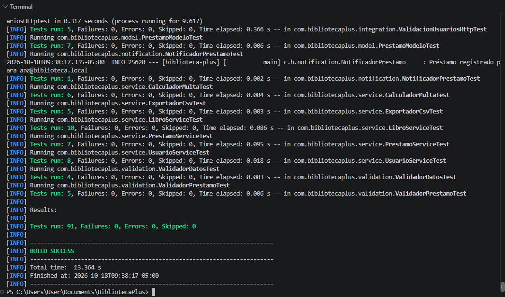
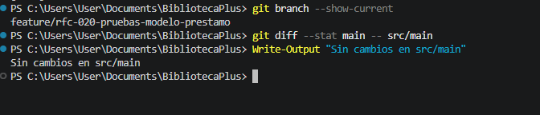

# RFC-020 · Pruebas automatizadas del modelo Prestamo

| Campo | Valor |
|---|---|
| Issue | [#18](https://github.com/nn-nnhub/BibliotecaPlus/issues/18) |
| Tipo de mantenimiento | Preventivo |
| Riesgo | Bajo |
| Prioridad | Media |
| Costo estimado | Bajo |
| Responsable | Keivan Yadir Valencia Lezameta |
| Fecha propuesta | 17/10/2026 |
| Etiquetas | RFC · Media · Mejora |

## Relación con el RFC

Este RFC trata un único cambio: agregar pruebas unitarias directas para la entidad `Prestamo`. No modifica código de producción, interfaz ni la persistencia H2 (RFC-008), y no altera las pruebas de `PrestamoService` de otros RFC.

## Descripción del cambio

Se agrega la clase `PrestamoModeloTest` en `src/test/java/com/bibliotecaplus/model/` con 7 pruebas:

| Prueba | Verifica |
|---|---|
| `constructorAsignaIdsYFechas` | El constructor guarda libro, usuario y fechas. |
| `prestamoNuevoQuedaSinDevolverYSinMulta` | `devuelto = false`, `multa = 0` y sin fecha de devolución. |
| `sinTipoSeLeeComoDomicilio` | Un préstamo sin tipo se lee como `DOMICILIO`. |
| `conTipoAsignadoSeDevuelveEseTipo` | Un tipo asignado se respeta. |
| `tipoNuloVuelveAlTipoPorDefecto` | Asignar `null` vuelve a `DOMICILIO`. |
| `settersDeDevolucionYMultaActualizanElEstado` | Setters de devolución y multa. |
| `settersDeIdsYFechasActualizanElPrestamo` | Setters de ids y fechas. |

## Justificación

`Prestamo` concentra reglas que usan varios servicios: el tipo por defecto que protege a los préstamos históricos (RFC-009), el estado de devolución y la multa. No tenía pruebas propias, por lo que un cambio accidental solo se detectaba de forma indirecta en los servicios.

## Impacto en el sistema

- Se agrega un solo archivo en `src/test`.
- No se modifica ningún archivo de `src/main` (ver evidencia).
- No se toca `application.properties` ni la configuración de H2.

## Criterios de aceptación

1. Un préstamo nuevo queda sin devolver y con multa 0.
2. Un préstamo sin tipo se lee como `DOMICILIO`.
3. Asignar un tipo lo devuelve tal cual; asignar `null` vuelve a `DOMICILIO`.
4. `mvn clean test` termina en `BUILD SUCCESS`.
5. `git diff --stat main -- src/main` no muestra cambios.

## Evidencias visuales

### Pruebas automatizadas



### Código de producción sin cambios



## Resultado

- 7 pruebas nuevas, todas exitosas.
- Suite completa: 91 pruebas, 0 fallos, 0 errores.
- Código de producción sin cambios.

## Validación automatizada

Comandos ejecutados (PowerShell, desde la raíz del proyecto):

```powershell
mvn test "-Dtest=PrestamoModeloTest"
mvn clean test
git diff --stat main -- src/main
```

Resultado: `PrestamoModeloTest` con `Tests run: 7, Failures: 0, Errors: 0`; suite completa con `Tests run: 91, Failures: 0, Errors: 0, Skipped: 0` y `BUILD SUCCESS`.

## Riesgos y limitaciones

- Las pruebas fijan el comportamiento actual de `Prestamo`. Si un RFC futuro lo cambia a propósito (por ejemplo, un campo `renovado`), habrá que ajustar o ampliar esta clase.
- No prueba persistencia ni la API; eso corresponde a pruebas de integración de otros RFC.
- El total de 91 pruebas corresponde a la rama del RFC-020 tomada desde `main` al momento de la captura; puede variar cuando se integren otros RFC.