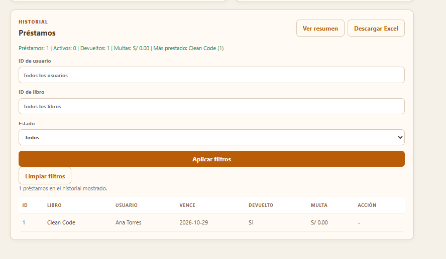
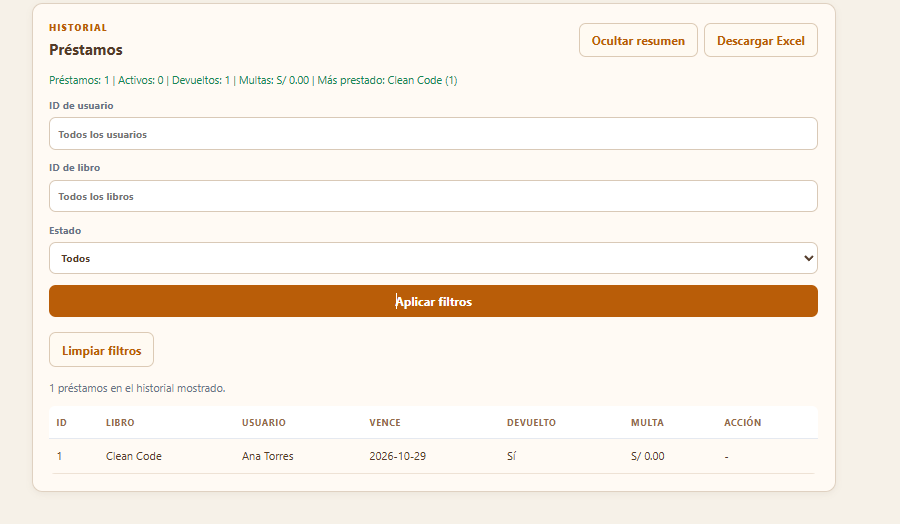

# RFC-021 · Resumen y separación de filtros del historial

## Identificación y trazabilidad

| Campo | Referencia |
|---|---|
| Issue | [#32](https://github.com/nn-nnhub/BibliotecaPlus/issues/32) |
| Pull request | [#33](https://github.com/nn-nnhub/BibliotecaPlus/pull/33) |
| Estado | Integrado en `main`; issue cerrado |

## Objetivo y justificación

Mostrar u ocultar el resumen y separar las acciones de filtros.

## Implementación e impacto

Botón alternante, descarte de respuestas tardías y espaciado.

## Pruebas y evidencias

Pruebas JavaScript y capturas antes/después. Los resultados y capturas originales se conservan en el registro detallado.

## Registro detallado

- Solicitud: [Issue #32](https://github.com/nn-nnhub/BibliotecaPlus/issues/32)
- Tipo: correctivo y perfectivo.
- Riesgo, prioridad y costo estimado: bajos.
- Responsable: nn-nnhub. Fecha propuesta: 08/11/2026.
- Etiquetas: RFC, Baja, Mejora y Bug.

### Antes

El botón **Ver resumen** volvía a consultar el reporte en cada clic y no permitía ocultarlo. **Limpiar filtros** quedaba pegado a **Aplicar filtros**.

### Cambio aplicado

El botón alterna entre **Ver resumen** y **Ocultar resumen**, muestra el resultado en verde y descarta respuestas tardías. Las acciones tienen 20 px de separación y 18 px adicionales antes del estado del historial. Las URL del JavaScript y CSS se versionaron para evitar que se reutilicen recursos antiguos con el HTML actualizado. Se conservan la API, los filtros y los datos.

### Validación

La captura del usuario muestra el resumen en verde, el botón **Ocultar resumen** y la separación alrededor de **Limpiar filtros**.

- Suite JavaScript: 21 pruebas aprobadas. Dos casos nuevos comprueban el cierre sin otra consulta y que una respuesta tardía no repone el resumen.
- La captura confirma el estado abierto y el espaciado. El estado cerrado se comprueba con la prueba automatizada; no se adjunta una captura de ese estado.
