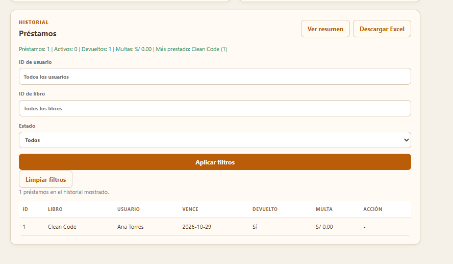

# RFC-021 · Resumen y filtros del historial

- Solicitud: [Issue #32](https://github.com/nn-nnhub/BibliotecaPlus/issues/32)
- Tipo: correctivo y perfectivo.
- Riesgo, prioridad y costo estimado: bajos.
- Responsable: nn-nnhub. Fecha propuesta: 08/11/2026.
- Etiquetas: RFC, Baja, Mejora y Bug.

## Antes

El botón **Ver resumen** volvía a consultar el reporte en cada clic y no permitía ocultarlo. **Limpiar filtros** quedaba pegado a **Aplicar filtros**.

## Cambio aplicado

El botón alterna entre **Ver resumen** y **Ocultar resumen**, actualiza su estado accesible y descarta respuestas tardías de consultas anteriores. El botón **Limpiar filtros** queda 12 px más abajo. Se conservan la API, el comportamiento de los filtros y los datos.

## Validación

- Suite JavaScript: 21 pruebas aprobadas. Dos casos nuevos comprueban el cierre sin otra consulta y que una respuesta tardía no repone el resumen.
- Comprobación visual manual pendiente: abrir el historial, mostrar y ocultar el resumen, aplicar un filtro y comprobar que **Limpiar filtros** tiene separación y restablece la lista.
