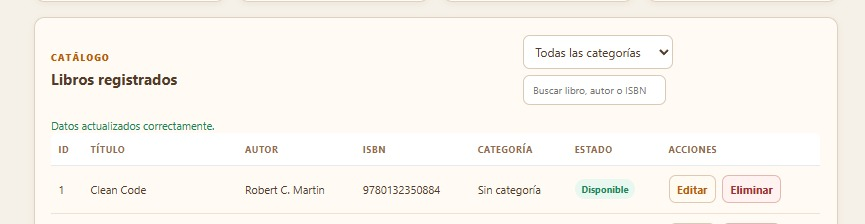
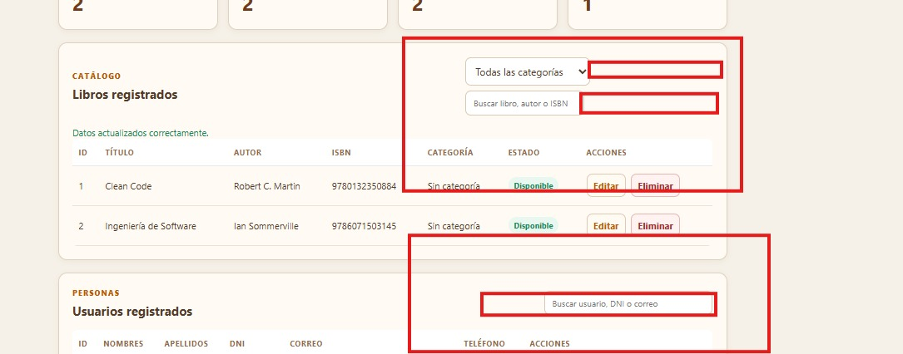
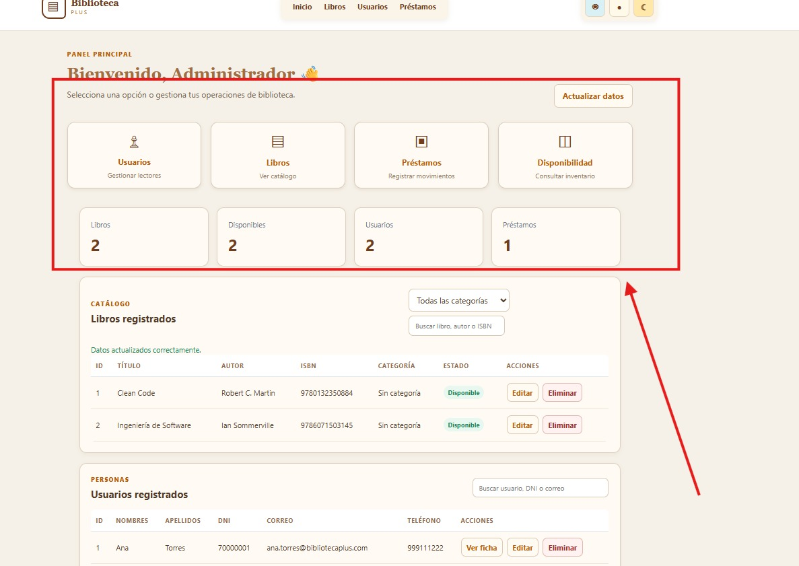
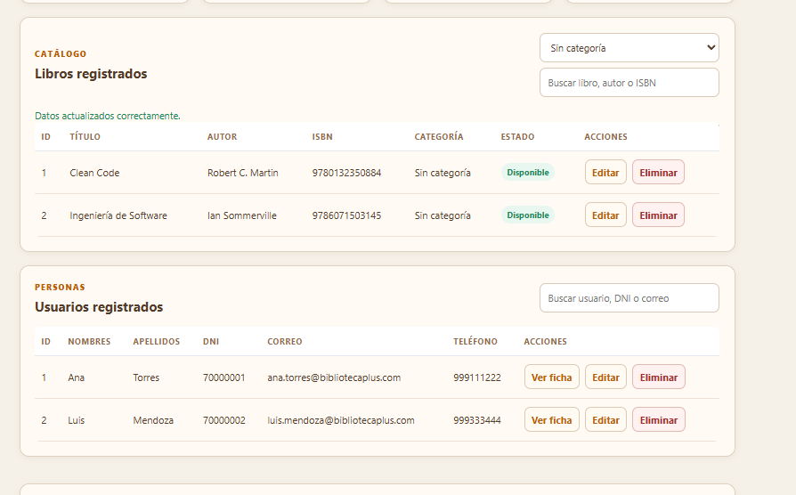

# RFC-022 · Alineación de filtros y accesos rápidos del panel

## Identificación y trazabilidad

- Solicitud [#35](https://github.com/nn-nnhub/BibliotecaPlus/issues/35).
- Propuesta del 08/11/2026. Mantenimiento perfectivo, prioridad baja y riesgo bajo.
- Validado por el usuario. Integración y cierre gestionados mediante el [PR #36](https://github.com/nn-nnhub/BibliotecaPlus/pull/36).

## Objetivo y justificación

El selector de categoría y los buscadores se mostraban con tamaños y alineaciones diferentes. La tarjeta Disponibilidad compartía destino con Libros y la cabecera fija podía cubrir la sección al seguir un enlace.

## Implementación e impacto

Los buscadores y el selector comparten estilos de ancho, altura mínima y espaciado. En pantallas estrechas ocupan el ancho del panel. Usuarios abre Usuarios registrados, Libros abre Libros registrados, Préstamos abre Registrar préstamo y Disponibilidad lleva directamente a la tabla de inventario que muestra el estado de cada libro. Las anclas dejan espacio bajo la cabecera y permiten enfocar el destino.

## Pruebas y evidencias

- `node --test "src/test/js/*.test.js"` pasó 90 pruebas.
- Se comprobó en el HTML que cada tarjeta tiene un destino único y enfocable y que ambos paneles usan el grupo de filtros compartido.
- El usuario confirmó la alineación de los controles y el funcionamiento de los accesos rápidos. La captura posterior muestra los tres controles alineados a la derecha.

### Capturas del estado anterior

### Captura del estado posterior

