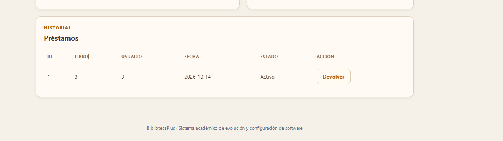

# Cambios de interfaz y experiencia de usuario

## Motivo del cambio

La primera versión mostraba el historial utilizando solamente `libroId` y `usuarioId`. Además, la interfaz no tenía una identidad visual clara ni controles de accesibilidad.

## Cambios realizados

### Estructura

- Se organizó la aplicación como un dashboard único.
- Se separaron los módulos mediante secciones de Libros, Usuarios, Préstamos y Disponibilidad.
- Se mantuvieron los datos y la comunicación con la API en `app.js`.
- Se separaron los controles visuales en `ui.js`.

### Identidad visual

- Se aplicaron colores beige, marrón, naranja y dorado.
- Se agregó una cabecera con identidad de biblioteca.
- Se agregaron tarjetas para acceder a los módulos.
- Se mejoraron bordes, espaciado, jerarquía tipográfica y estados visuales.

### Accesibilidad

- Menú de accesibilidad.
- Visión baja con texto grande.
- Interlineado para dislexia.
- Alto contraste.
- Máscara de lectura que sigue el cursor.
- Botón para restablecer los ajustes.

### Historial de préstamos

Antes se mostraba:

```text
Libro: 3
Usuario: 3
```

Ahora se muestra el título del libro y el nombre del usuario. Los identificadores siguen existiendo internamente, pero no se exponen como información principal al usuario.

## Evidencia visual

La captura siguiente corresponde al estado anterior del historial:



## Archivos involucrados

| Archivo | Responsabilidad |
|---|---|
| `index.html` | Estructura del dashboard y formularios |
| `styles.css` | Identidad visual, responsive y modo oscuro |
| `app.js` | Comunicación con la API y renderizado de datos |
| `ui.js` | Accesibilidad, tema y sesión activa |
