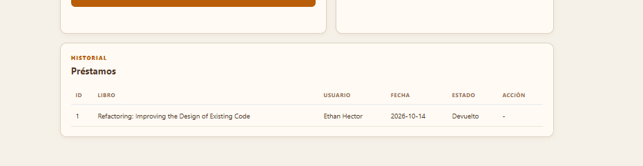
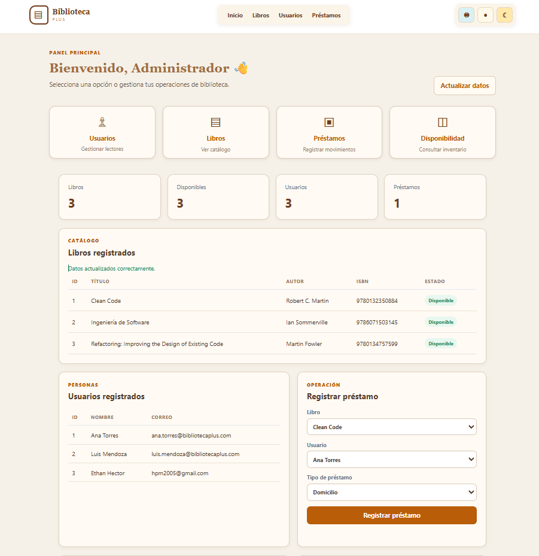
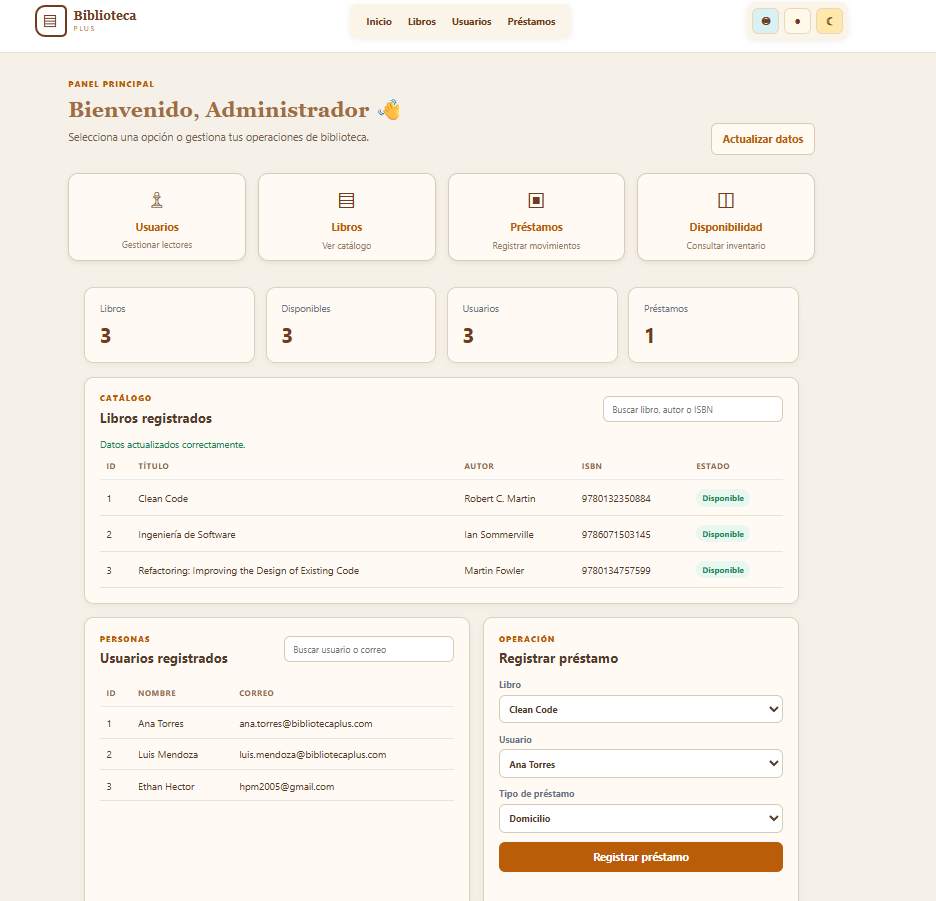

# Cambios de interfaz y experiencia de usuario

## Motivo del cambio

La primera versión mostraba el historial utilizando solamente `libroId` y `usuarioId`. Además, la interfaz no tenía una identidad visual clara ni controles de accesibilidad.

## Cambios realizados

### Estructura

- Se organizó la aplicación como un dashboard único.
- Se separaron los módulos mediante secciones de Libros, Usuarios, Préstamos y Disponibilidad.
- Se mantuvieron los datos y la comunicación con la API en `app.js`.
- Se separaron los controles visuales en `ui.js`.

### Identidad visual

- Se aplicaron colores beige, marrón, naranja y dorado.
- Se agregó una cabecera con identidad de biblioteca.
- Se agregaron tarjetas para acceder a los módulos.
- Se mejoraron bordes, espaciado, jerarquía tipográfica y estados visuales.

### Accesibilidad

- Menú de accesibilidad.
- Visión baja con texto grande.
- Interlineado para dislexia.
- Alto contraste.
- Máscara de lectura que sigue el cursor.
- Botón para restablecer los ajustes.

### Historial de préstamos

Antes se mostraba:

```text
Libro: 3
Usuario: 3
```

Ahora se muestra el título del libro y el nombre del usuario. Los identificadores siguen existiendo internamente, pero no se exponen como información principal al usuario.

### Búsqueda

- Se agregó una barra de búsqueda para libros por título, autor o ISBN.
- Se agregó una barra de búsqueda para usuarios por nombre o correo.
- El filtrado se realiza en la interfaz sobre los datos ya cargados, evitando llamadas innecesarias al servidor.
- La búsqueda se mantiene separada de la lógica Java y se implementa en `app.js`.

### Tablas con muchos registros

La captura `capturas/tablas-antes-desplazamiento.png` evidencia el estado anterior, donde las tablas podían crecer verticalmente sin límite.

Se agregó una altura máxima de 280 píxeles a los contenedores de libros, usuarios e historial. Cada tabla tiene ahora su propia barra desplazadora vertical y sus encabezados permanecen visibles durante el desplazamiento.

La prueba completa con 100 libros reales y 100 usuarios ficticios está documentada en [prueba-desplazamiento.md](prueba-desplazamiento.md).

El cambio de vencimientos y multas está documentado en [RFC-004-vencimientos-y-multas.md](RFC-004-vencimientos-y-multas.md).

La ampliación de datos de usuario está documentada en [RFC-005-informacion-usuario.md](RFC-005-informacion-usuario.md).

La validación de DNI duplicado está documentada en [RFC-006-dni-duplicado.md](RFC-006-dni-duplicado.md).

Después del RFC-005 se realizó un ajuste de interfaz: la tabla ampliada de usuarios pasó a ocupar todo el ancho disponible para evitar que correo y teléfono quedaran comprimidos junto al formulario de préstamos.

## Evidencia visual

La captura siguiente corresponde al estado anterior del historial:


La captura siguiente evidencia el historial después de la mejora:



## Evidencia de la búsqueda

Vista antes de agregar las barras de búsqueda:



Vista después de agregar las barras de búsqueda:



## Archivos involucrados

| Archivo | Responsabilidad |
|---|---|
| `index.html` | Estructura del dashboard y formularios |
| `styles.css` | Identidad visual, responsive y modo oscuro |
| `app.js` | Comunicación con la API y renderizado de datos |
| `ui.js` | Accesibilidad, tema y sesión activa |
