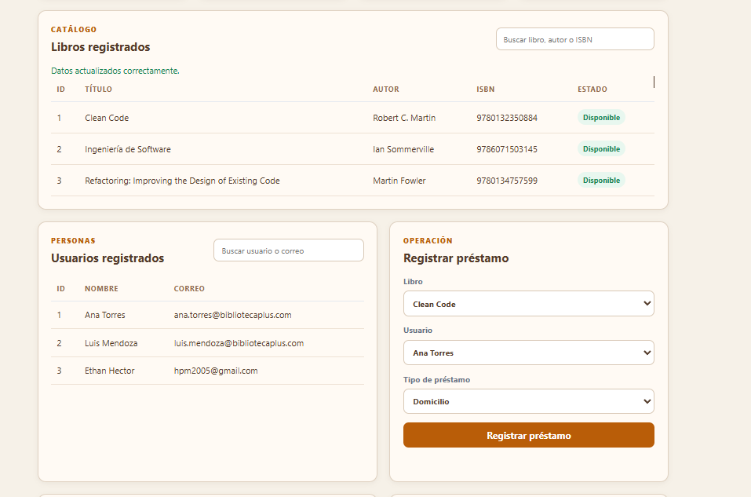
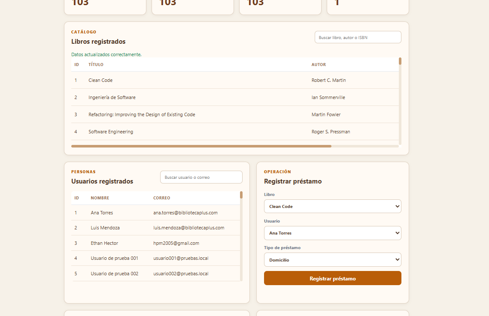

# Prueba de desplazamiento con datos masivos

## Objetivo

Verificar que las tablas de libros y usuarios mantengan una altura controlada y muestren barras desplazadoras cuando la cantidad de registros aumenta.

## Situación inicial

Antes del cambio, las tablas podían crecer verticalmente con cada nuevo registro. Esto podía desplazar demasiado el resto del dashboard y dificultar la navegación.

La evidencia del estado anterior se encuentra en:



## Decisión de diseño

Se decidió mantener los módulos en un dashboard único, pero encapsular cada tabla dentro de su propio contenedor desplazable. Esta decisión permite:

- Mantener juntos los módulos de libros, usuarios y préstamos.
- Evitar que la página crezca indefinidamente.
- Consultar muchos registros sin cambiar de vista.
- Mantener una experiencia coherente con la búsqueda incorporada.
- Reservar la paginación para una futura necesidad de mayor escala.

## Implementación

El cambio se implementó en `src/main/resources/static/styles.css`:

```css
.table-wrapper {
    max-height: 280px;
    overflow: auto;
}
```

Además:

- El encabezado de cada tabla permanece visible mediante `position: sticky`.
- Se agregó estilo visual a las barras desplazadoras.
- Se conservaron los desplazamientos horizontal y vertical.
- No se modificó la lógica Java ni el contrato de la API.

## Preparación de los datos de prueba

Para comprobar el comportamiento con una cantidad significativa de registros:

1. Se inició BibliotecaPlus en el puerto 8080.
2. Se obtuvieron 100 libros con datos bibliográficos reales desde Open Library.
3. Se registraron los libros mediante `POST /api/libros`.
4. Se generaron 100 usuarios ficticios de prueba, sin utilizar datos personales reales.
5. Se registraron mediante `POST /api/usuarios`.
6. Se verificó la cantidad mediante `GET /api/libros` y `GET /api/usuarios`.

La aplicación mostró 103 libros y 103 usuarios porque ya tenía 3 registros iniciales cargados por `DataInitializer.java`.

## Resultado observado

La captura final muestra:

- Barra vertical en la tabla de libros.
- Barra horizontal en la tabla de libros debido al ancho de columnas.
- Barra vertical en la tabla de usuarios.
- Encabezados de columnas visibles.
- Búsqueda disponible en ambas tablas.
- Dashboard estable sin crecer indefinidamente.



## Limpieza de datos

Los datos fueron temporales. La base de datos H2 utiliza memoria (`jdbc:h2:mem:bibliotecadb`), por lo que los registros desaparecen al detener y reiniciar la aplicación.

## Resultado de la prueba

| Verificación | Resultado |
|---|---|
| Se cargaron 100 libros reales | Correcto |
| Se cargaron 100 usuarios ficticios | Correcto |
| La tabla de libros mostró desplazamiento | Correcto |
| La tabla de usuarios mostró desplazamiento | Correcto |
| Se mantuvo la búsqueda | Correcto |
| Se mantuvieron visibles los encabezados | Correcto |
| La aplicación continuó funcionando | Correcto |
